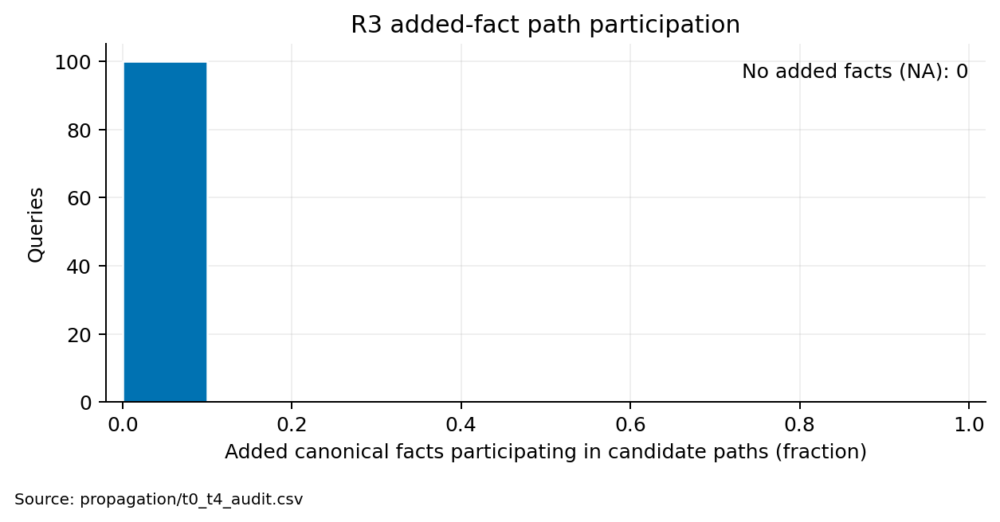
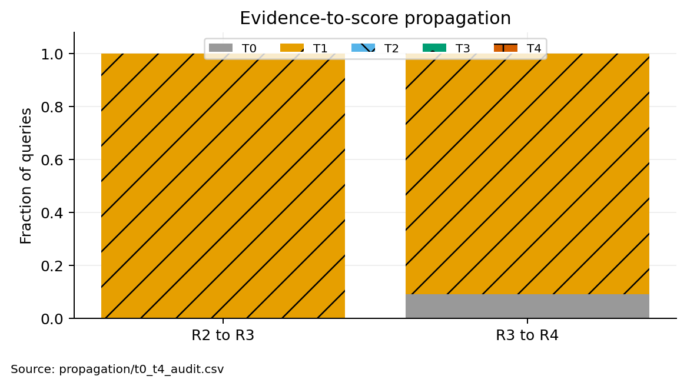
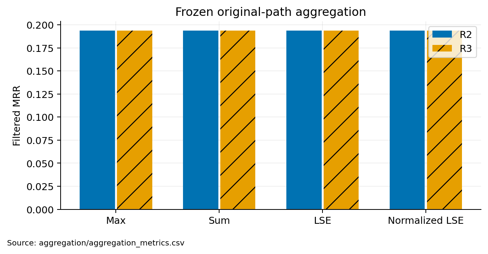
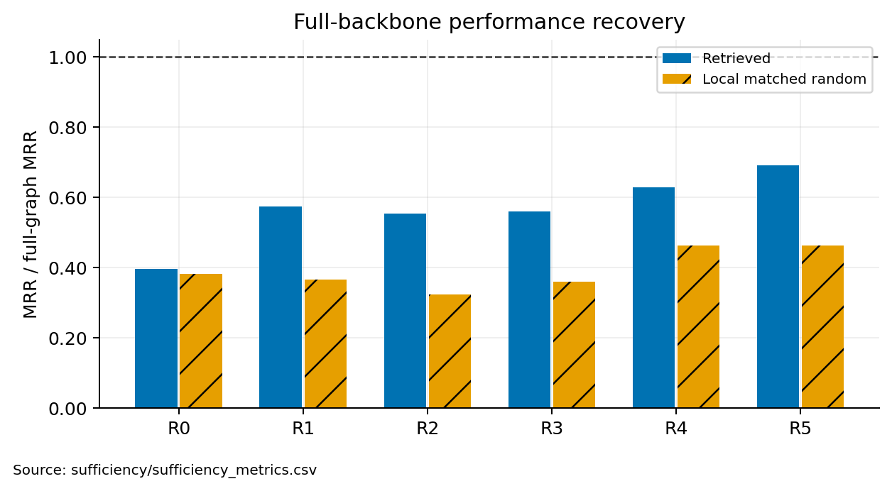
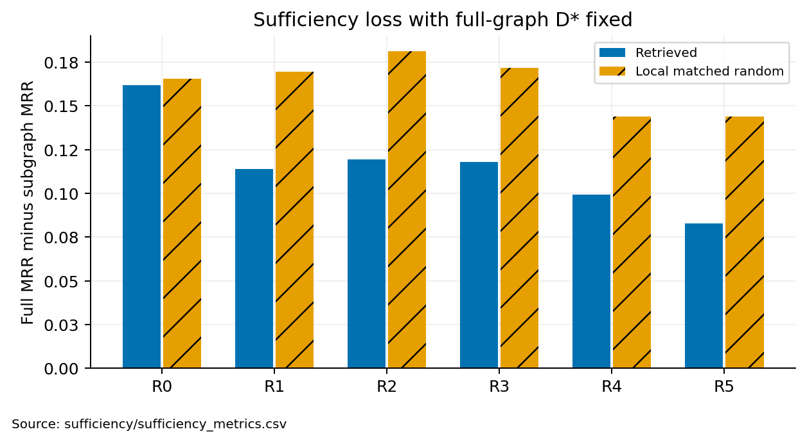
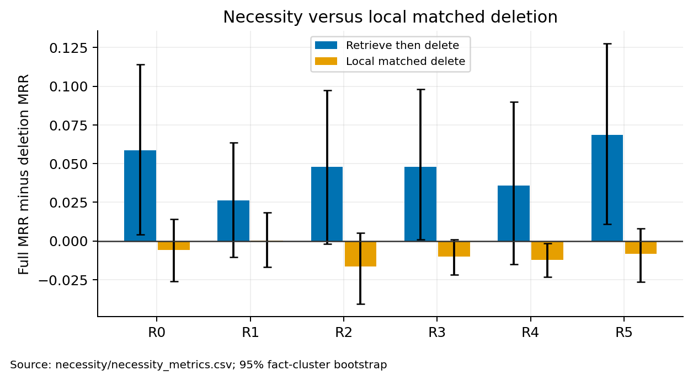
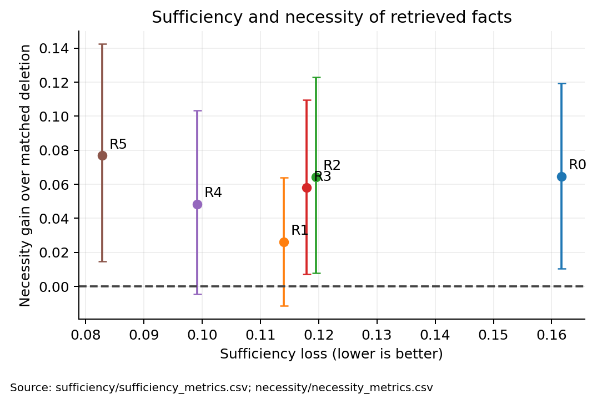

# P2-A Stage 1 · V2.1 结构证据审计

运行状态 complete，查询 100 条，独立事实 50 条。API 请求 0 次。
## 1. 背景

P1 中 R2–R4 选中的事实集合不同，但候选证据排序相同。本阶段逐级追踪事实、候选路径、原路径效用、分数及排名，并在冻结 B2+D* 上测试证据充分性与必要性。
## 2. 环境与冻结配置

CPU AMD Ryzen 7 6800H with Radeon Graphics。GPU NVIDIA GeForce RTX 3060 Laptop GPU，显存 6.00 GiB。Python 3.9.23，PyTorch 2.1.0+cu118，CUDA 11.8。
Git 6c30d004a106bef0ee4a31562c897799f9b768b9。B2 检查点 SHA256 为 `1e85a7e85b57afa14b5b79813bab85c0fd075323b16ac05a5948f200c2aed790`。模型参数加载及结束哈希均为 `329cec9b4c64e839596d6c0f8de5eab26a8cdb0ca976f71a3cf9786fee6ab121`。
全图关系表示文件哈希 `d7a6cf96e7a1bdf6558e67f622b2dc50905713d04f1bb638501b720471dab15a`。D* 文件哈希 `d2c24377b71232606120006046f6603c1fc512166824d9d6cdc004576a96484f`。
实际张量峰值 172.1 MiB，CUDA 保留峰值 206.0 MiB。反事实期间关系编码器调用 0 次，D* 缓存逐次校验固定。批次调整记录 []。
## 3. 资产与协议

P1 为 180f77feccfea1f7dfc26a86cb2162073444df55，运行 b2273b01f095035cf925fd78ab456213ecf706d21e90c130024c41fc458997b4。全部 R0–R5 实际记录已找到。完整候选与原批次全图评分逐实体的未过滤倒数秩、原过滤名次一致。B0.npz 的真实字段和形状保存在 historical_schema.json。证据测试是新执行的模型推理，原始资产核对见 asset_audit.md。
FBIngram_25 沿用原测试划分、离线过滤集合、原始实体与关系编号。样本在 P1 固定查询资产内按种子 20261122 选择 50 条事实及两个方向。事实 ID 按正向三元组规范化，同一事实的逆向和重复记录计一次预算。路径审计使用原选择方向。保真度输入则对唯一事实恢复全图中的逆向与重复消息记录。
D* 原始全图均值 0.18232500，均值锚定后 1.00000003。历史 Triton 的发送端是 edge_index[1]。所有图复用全图 a/b/z、原 float32 锚点与固定查询 alpha，保持完整 4097 实体空间。关系编码器始终看到原全图关系超图，子图仅替换第二阶段 edge_index/edge_type。
历史 Top-12 是未过滤生成；一致性指标以全实体未过滤 Top-1、Top-10 比较。最终指标用原过滤排名和悲观并列规则。
## 4. R2–R4 影响传播

| 对比 | T0 | T1 | T2 | T3 | T4 | 新增唯一事实 | 路径参与事实 | 平均路径参与率 |
|---|---:|---:|---:|---:|---:|---:|---:|---:|
| R2→R3 | 0 (0.0%) | 100 (100.0%) | 0 (0.0%) | 0 (0.0%) | 0 (0.0%) | 1792 | 0 | 0.0000 |
| R3→R4 | 9 (9.0%) | 91 (91.0%) | 0 (0.0%) | 0 (0.0%) | 0 (0.0%) | 1048 | 0 | 0.0000 |

新增事实为零的查询路径参与率记录 NA。路径包含全部三跳内有向简单路径，Gq 中潜在参与率另列。“新增实体高阶模体实例”缺少历史对应定义，报告为 NA，本阶段未引入新接地算法。
代码审计发现 P1 retrieval.py 的 choose_pcst 先保护候选骨干，将其中全部节点收缩到查询根，再跳过收缩后两端相同的边，最后按根连通性添加扩展。这一结构限制会偏向骨干外围的事实，上述路径参与数据用于判断该偏置在本批查询中是否发生。原 Max 评分的损失需在确实出现新候选路径后再判断。
每组输入和再次执行的输入哈希、节点、关系、路径与效用保存于 input_consistency.csv / scoring_inputs.json。本阶段 T4 定义为候选分数或排名发生变化，与此前 P2 的分类规则分别保存。
## 5. 固定路径聚合

四组聚合共用 P1 原枚举路径和效用，温度固定 0.08，空路径统一回退 0。Sum 和非归一化 LSE 的路径数量偏置通过分数与路径数、度数相关系数检查。
| 组 | 聚合 | MRR | H@1 | H@10 | 平均名次 | Top-1 改变率 | R2/R3 顺序一致 | 路径数相关 | 出度相关 |
|---|---|---:|---:|---:|---:|---:|---:|---:|---:|
| R2 | Max | 0.1939 | 0.0500 | 0.5300 | 74.93 | 0.3900 | 1.0000 | -0.1952 | -0.0285 |
| R2 | Sum | 0.1939 | 0.0500 | 0.5300 | 74.93 | 0.3900 | 1.0000 | -0.1952 | -0.0285 |
| R2 | LogSumExp | 0.1939 | 0.0500 | 0.5300 | 74.93 | 0.3900 | 1.0000 | -0.1952 | -0.0285 |
| R2 | NormalizedLogSumExp | 0.1939 | 0.0500 | 0.5300 | 74.93 | 0.3900 | 1.0000 | -0.1952 | -0.0285 |
| R3 | Max | 0.1939 | 0.0500 | 0.5300 | 74.93 | 0.3900 | 1.0000 | -0.1952 | -0.0285 |
| R3 | Sum | 0.1939 | 0.0500 | 0.5300 | 74.93 | 0.3900 | 1.0000 | -0.1952 | -0.0285 |
| R3 | LogSumExp | 0.1939 | 0.0500 | 0.5300 | 74.93 | 0.3900 | 1.0000 | -0.1952 | -0.0285 |
| R3 | NormalizedLogSumExp | 0.1939 | 0.0500 | 0.5300 | 74.93 | 0.3900 | 1.0000 | -0.1952 | -0.0285 |

## 6. 固定主干充分性

| 方法 | 唯一事实 | 消息边 | MRR | H@1 | H@10 | 平均名次 | Top-1 一致 | Top-10 重合 | 充分性损失 ±95% CI | 恢复比例 |
|---|---:|---:|---:|---:|---:|---:|---:|---:|---|---:|
| G_full | 17147.0 | 34294.0 | 0.2681 | 0.1000 | 0.5800 | 73.99 | 1.0000 | 1.0000 | +0.0000 [+0.0000, +0.0000] | 1.0000 |
| G_local | 409.6 | 819.1 | 0.2309 | 0.1200 | 0.4800 | 1073.82 | 0.6800 | 0.8430 | +0.0372 [+0.0000, +0.0744] | 0.8613 |
| R0 | 25.8 | 51.5 | 0.1064 | 0.0500 | 0.2300 | 3137.04 | 0.3800 | 0.5190 | +0.1617 [+0.0954, +0.2292] | 0.3968 |
| R1 | 18.3 | 36.7 | 0.1540 | 0.0700 | 0.3600 | 2487.10 | 0.1500 | 0.5910 | +0.1140 [+0.0475, +0.1795] | 0.5746 |
| R2 | 15.9 | 31.8 | 0.1485 | 0.0500 | 0.3900 | 2367.41 | 0.3800 | 0.8480 | +0.1195 [+0.0720, +0.1699] | 0.5541 |
| R3 | 32.0 | 64.0 | 0.1501 | 0.0400 | 0.3700 | 2442.34 | 0.4200 | 0.7910 | +0.1179 [+0.0742, +0.1618] | 0.5600 |
| R4 | 31.9 | 63.8 | 0.1689 | 0.0400 | 0.4500 | 2119.05 | 0.4500 | 0.8080 | +0.0992 [+0.0565, +0.1449] | 0.6299 |
| R5 | 31.9 | 63.9 | 0.1852 | 0.0800 | 0.4400 | 2161.14 | 0.4300 | 0.8210 | +0.0828 [+0.0424, +0.1251] | 0.6910 |
| Random_R0 | 25.8 | 51.5 | 0.1025 | 0.0340 | 0.2620 | 2923.12 | 0.1090 | 0.3633 | +0.1656 [+0.1062, +0.2252] | 0.3823 |
| Random_R1 | 18.3 | 36.7 | 0.0983 | 0.0360 | 0.2580 | 2976.08 | 0.1970 | 0.3817 | +0.1697 [+0.1175, +0.2241] | 0.3669 |
| Random_R2 | 15.9 | 31.8 | 0.0869 | 0.0270 | 0.2180 | 3170.44 | 0.1670 | 0.2802 | +0.1811 [+0.1289, +0.2363] | 0.3244 |
| Random_R3 | 32.0 | 64.0 | 0.0965 | 0.0340 | 0.2290 | 3005.53 | 0.1720 | 0.3052 | +0.1716 [+0.1211, +0.2242] | 0.3599 |
| Random_R4 | 31.9 | 63.8 | 0.1243 | 0.0420 | 0.3120 | 2674.20 | 0.1570 | 0.3528 | +0.1438 [+0.0858, +0.2033] | 0.4637 |
| Random_R5 | 31.9 | 63.9 | 0.1242 | 0.0360 | 0.3210 | 2661.60 | 0.1790 | 0.3728 | +0.1439 [+0.0870, +0.2006] | 0.4632 |

## 7. 局部匹配随机删除与必要性

随机事实从逆向闭包后的同一个 Gq 的唯一事实空间抽样，先排除检索事实。分层首先精确匹配关系与头部跳数，然后匹配跳数与关系全图频次三分位，依次放宽为同跳数、同频次、局部任意。仅在局部剩余预算不足时允许与检索事实重叠，并逐条记录。跳数根据局部图与头实体最短距离，超过三跳或不可达单列第 4 桶。每查询、每检索组 10 个固定种子控制。充分性和必要性共用相同随机样本。
| 方法 | 删除后跌落 | 随机删除跌落 | 必要性增量 | 95% CI | 查询内随机标准差 | 正/负查询 |
|---|---:|---:|---:|---|---:|---:|
| R0 | +0.0587 | -0.0060 | +0.0647 | [+0.0103, +0.1193] | 0.0435 | 61/34 |
| R1 | +0.0262 | +0.0000 | +0.0262 | [-0.0115, +0.0640] | 0.0460 | 47/43 |
| R2 | +0.0477 | -0.0166 | +0.0643 | [+0.0079, +0.1228] | 0.0365 | 51/43 |
| R3 | +0.0478 | -0.0102 | +0.0579 | [+0.0072, +0.1096] | 0.0333 | 50/42 |
| R4 | +0.0359 | -0.0124 | +0.0484 | [-0.0046, +0.1035] | 0.0420 | 53/39 |
| R5 | +0.0686 | -0.0084 | +0.0770 | [+0.0146, +0.1424] | 0.0368 | 57/37 |

## 8. 综合表与配对统计

Bootstrap 10000 次、95% 区间。先合并每查询 10 次随机结果，再以原始事实为聚类单元同时重采两个方向。均值、查询级标准差和方法间配对差异见 CSV。
| 方法 | 事实数 | 全部选中事实路径参与率 | 子图 MRR | 充分性损失 | 恢复比例 | 必要性增量 |
|---|---:|---:|---:|---:|---:|---:|
| R0 | 25.8 | 0.3127 | 0.1064 | +0.1617 | 0.3968 | +0.0647 |
| 匹配随机(R0) | 25.8 | NA | 0.1025 | +0.1656 | 0.3823 | NA |
| R1 | 18.3 | 0.0283 | 0.1540 | +0.1140 | 0.5746 | +0.0262 |
| 匹配随机(R1) | 18.3 | NA | 0.0983 | +0.1697 | 0.3669 | NA |
| R2 | 15.9 | 0.9131 | 0.1485 | +0.1195 | 0.5541 | +0.0643 |
| 匹配随机(R2) | 15.9 | NA | 0.0869 | +0.1811 | 0.3244 | NA |
| R3 | 32.0 | 0.4344 | 0.1501 | +0.1179 | 0.5600 | +0.0579 |
| 匹配随机(R3) | 32.0 | NA | 0.0965 | +0.1716 | 0.3599 | NA |
| R4 | 31.9 | 0.4362 | 0.1689 | +0.0992 | 0.6299 | +0.0484 |
| 匹配随机(R4) | 31.9 | NA | 0.1243 | +0.1438 | 0.4637 | NA |
| R5 | 31.9 | 0.5504 | 0.1852 | +0.0828 | 0.6910 | +0.0770 |
| 匹配随机(R5) | 31.9 | NA | 0.1242 | +0.1439 | 0.4632 | NA |

## 9. 真实失败与变化案例

- 新增事实未进入候选路径见 FBIngram_25:204:0，新增唯一事实 19，路径参与 0，特征差 0.000000，分数差 0.000000，目标名次 5→5。
- 候选评分或顺序未变化见 FBIngram_25:204:0，新增唯一事实 19，路径参与 0，特征差 0.000000，分数差 0.000000，目标名次 5→5。
- 最大检索删除跌落见 FBIngram_25:5138:0、R0，目标原名次 1，删除后 21，RR 跌落 +0.9524。
- 删除影响相近见 FBIngram_25:2419:0、R1，检索删除跌落 +0.0000，随机平均 +0.0000。原事实 ID 和随机种子见逐查询检查点及 random_deletion_details.csv。

## 10. Stage 1 Go / No-Go

当前判断为 **Go**。超出局部随机对照且 95% 区间下界大于零的方法为 ['R0', 'R1', 'R2', 'R3', 'R5']。判断同时保留点估计和统计不确定性。若外围扩展存在明确偏置，允许按 Conditional Go 修正问题后再验证。
## 11. 后续与可复现性

首先根据单图有限样本的充分性和必要性确定保留哪些证据结构。外围奖励偏置和路径聚合按本次传导结果处理，后续研究选择应基于对应的反事实增量。本阶段仅提供冻结模型评价，未训练、未实现实体级模体接地。自动入口 scripts/run_all.py，参数、代码哈希、查询列表和模型证明均已保存。

10 条查询冒烟实际耗时 36.5 秒，外推 100 条剩余耗时约 328 秒。该值仅按实测吞吐量外推，受初始化、缓存和负载影响。

