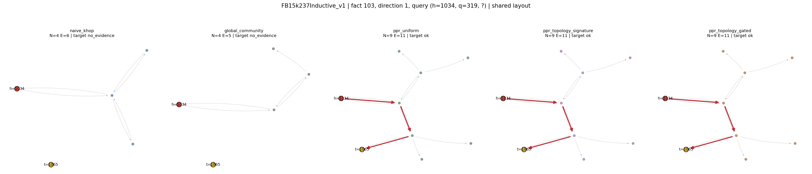
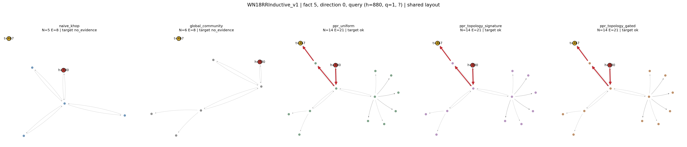
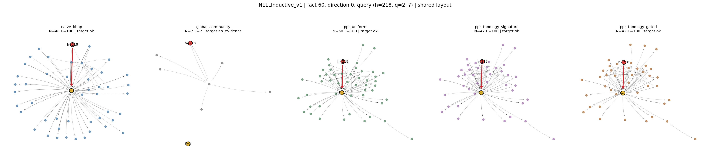

# MOTIF 查询感知强关联社区发现实验报告

本报告对应运行 `d48ae432a2533cdaaec0`。状态：完成。范围：全量测试事实、两个方向。

## 1. 核心结论与解释边界

模块已实现 A–E 全部流程，E 分为纯四维签名与实际冻结 T-4D 门控两种。下表及配对区间从原始逐查询记录生成；未预设 E 优于基线。没有接入 LLM，没有参数更新。

FB15k237Inductive_v1 / ppr_topology_signature 相对C：路径召回变化 +0.00 个百分点（区间含0，未建立显著提升）；枢纽占比变化 -0.45 个百分点（区间支持下降）；11–30扩召回成功 7/68。

FB15k237Inductive_v1 / ppr_topology_gated 相对C：路径召回变化 +0.00 个百分点（区间含0，未建立显著提升）；枢纽占比变化 -0.29 个百分点（区间支持下降）；11–30扩召回成功 4/68。

WN18RRInductive_v1 / ppr_topology_signature 相对C：路径召回变化 +0.00 个百分点（区间含0，未建立显著提升）；枢纽占比变化 +0.00 个百分点（区间含0）；11–30扩召回成功 7/58。

WN18RRInductive_v1 / ppr_topology_gated 相对C：路径召回变化 +0.00 个百分点（区间含0，未建立显著提升）；枢纽占比变化 +0.00 个百分点（区间含0）；11–30扩召回成功 3/58。

NELLInductive_v1 / ppr_topology_signature 相对C：路径召回变化 +0.00 个百分点（区间含0，未建立显著提升）；枢纽占比变化 +0.85 个百分点（区间支持上升）；11–30扩召回成功 0/23。

NELLInductive_v1 / ppr_topology_gated 相对C：路径召回变化 +0.00 个百分点（区间含0，未建立显著提升）；枢纽占比变化 +0.87 个百分点（区间支持上升）；11–30扩召回成功 0/23。

FBIngram_25 / ppr_topology_signature 相对C：路径召回变化 +0.06 个百分点（区间含0，未建立显著提升）；枢纽占比变化 -5.26 个百分点（区间支持下降）；11–30扩召回成功 20/2526。

FBIngram_25 / ppr_topology_gated 相对C：路径召回变化 +0.05 个百分点（区间含0，未建立显著提升）；枢纽占比变化 -4.59 个百分点（区间支持下降）；11–30扩召回成功 14/2526。

**数学限制：发送端全局度因子在行归一化时完全抵消。** 若 `w(u,r,v)=phi(r)/(1+d_out(u))^eta`，则 `P(v|u)=phi(r)/sum_(u,r′,v′)phi(r′)`。因此 E 的 PPR 转移差异来自关系重要性，发送端阻尼仅影响未归一化证据路径分数、预算选择及带权社区投影；D 中发送端全局度同样抵消，但关系局部扇出项仍起作用。不能将 PPR 变化归因为已被抵消的全局发送端度数。

以下 K=30、M=10 的 E−C 与 E−D 配对区间量化有效证据召回变化；区间跨 0 时不能声称显著改善。均为已暴露目标图上的离线诊断；多个比较未作多重校正，不构成新图泛化保证。

| 图谱 | 基线 | 方法 | Path Hit差 | 95%下界 | 95%上界 | 事实数 |
| --- | --- | --- | --- | --- | --- | --- |
| FB15k237Inductive_v1 | ppr_uniform | ppr_topology_signature | 0.0000 | 0.0000 | 0.0000 | 411 |
| FB15k237Inductive_v1 | ppr_uniform | ppr_topology_gated | 0.0000 | 0.0000 | 0.0000 | 411 |
| FB15k237Inductive_v1 | ppr_degree | ppr_topology_signature | 0.0000 | 0.0000 | 0.0000 | 411 |
| FB15k237Inductive_v1 | ppr_degree | ppr_topology_gated | 0.0000 | 0.0000 | 0.0000 | 411 |
| WN18RRInductive_v1 | ppr_uniform | ppr_topology_signature | 0.0000 | 0.0000 | 0.0000 | 373 |
| WN18RRInductive_v1 | ppr_uniform | ppr_topology_gated | 0.0000 | 0.0000 | 0.0000 | 373 |
| WN18RRInductive_v1 | ppr_degree | ppr_topology_signature | 0.0000 | 0.0000 | 0.0000 | 373 |
| WN18RRInductive_v1 | ppr_degree | ppr_topology_gated | 0.0000 | 0.0000 | 0.0000 | 373 |
| NELLInductive_v1 | ppr_uniform | ppr_topology_signature | 0.0000 | 0.0000 | 0.0000 | 201 |
| NELLInductive_v1 | ppr_uniform | ppr_topology_gated | 0.0000 | 0.0000 | 0.0000 | 201 |
| NELLInductive_v1 | ppr_degree | ppr_topology_signature | 0.0000 | 0.0000 | 0.0000 | 201 |
| NELLInductive_v1 | ppr_degree | ppr_topology_gated | 0.0000 | 0.0000 | 0.0000 | 201 |
| FBIngram_25 | ppr_uniform | ppr_topology_signature | 0.0006 | -0.0002 | 0.0014 | 5716 |
| FBIngram_25 | ppr_uniform | ppr_topology_gated | 0.0005 | -0.0003 | 0.0013 | 5716 |
| FBIngram_25 | ppr_degree | ppr_topology_signature | 0.0026 | 0.0017 | 0.0037 | 5716 |
| FBIngram_25 | ppr_degree | ppr_topology_gated | 0.0025 | 0.0015 | 0.0036 | 5716 |

## 2. P0 冻结、隔离与历史资产

- 原分支：`stage6-tsdc`；冻结提交：`5f1a91dd8a34c8d890735187caa8e7f5904fa0e9`；原归档工作区干净：`True`。
- 冻结标签：`baseline-4d-gate-frozen-20261108`；新分支：`experiment/query-community-v1`。
- Worktree：`D:\motif-phase4-work\query-community-v1-20261108`。全部新增代码、缓存、日志和结果位于其 `experiments/query_community_v1/`。
- 清单共 19538 个历史资产（41.61 GB），逐文件 SHA256 位于 `freeze_manifest.json`。冻结前未发现运行中的训练/评估。
- 本次保护验证：19538 个文件，模式=全量，全部哈希未变。

阶段一 ULTRA、阶段二/三 MOTIF、阶段四各拓扑子阶段、阶段五、阶段六两个实体算子版本与 TSDC、阶段七均已纳入清单。阶段三内核与阶段六 v2 的未提交修改及报告已另存 `preserved_changes/`，原目录不动；未将它们提交到正式冻结基线。Git 标签固定干净归档提交，外部未版本化历史资产依靠清单及保留原位置复现。

| 仓库 | 分支 | HEAD | 干净 |
| --- | --- | --- | --- |
| D:\ultra-phase1-work\ULTRA | main | 427966ad8ed60420eef034063d44f3153addff90 | True |
| D:\motif-phase2-work\MOTIF | main | 30b2ff3c64892a14f1715b3e929855fc1abd2c81 | True |
| D:\motif-phase3-work\MOTIF | main | 30b2ff3c64892a14f1715b3e929855fc1abd2c81 | False |
| D:\motif-phase4-work\github-archives\motif-stage5-ucos-20261103 | main | 173017b7c3a4d88edf73d2ce46b083a5fcb69354 | True |
| D:\motif-phase4-work\motif-stage6-entity-degree-p0p1 | stage6/entity-degree-p0p1 | deae5a3f55d13c6cbea6143f94dae4e0529d0c41 | True |
| D:\motif-phase4-work\motif-stage6-entity-degree-p0p1-v2 | stage6/entity-degree-v2 | 2f46975533503f6a5efde6de8114a996d6b8e680 | False |
| D:\motif-phase4-work\tsdc-stage6-20261103 | stage6-tsdc | 5f1a91dd8a34c8d890735187caa8e7f5904fa0e9 | True |

### 核心代码与模型 SHA256

| 文件 | SHA256 |
| --- | --- |

## 3. P1 四维签名与门控接口核查

类型序为 HH、TT、HT、TFH、TFT、HFT、HFH。原观察图含显式正逆边；令 C_H(v,r)、C_T(v,r) 为有向角色次数，U=1[C>0]，d(v) 为逆增强图发送度。二元模体 N=C_L^T C_S，Q=C_L^T diag(d^(-1/2)) C_S；三元模体沿中间关系 b 收缩，N=C_L^T F_b C_S，Q=(diag(d^(-1/4))C_L)^T F_b (diag(d^(-1/4))C_S)。

原始四通道为 [log(1+N), Q/N, RW, Q/(prod_j marginal_(type,j)(r_j))^(1/arity)]。RW 的头/尾角色质量 X_H(v,r)=sum_(v,r,t)1/d_(r,in)(t)，X_T(v,r)=sum_(u,r,v)1/d_(r,out)(u)；二元 RW=X_L^T U_S，三元 RW=X_L^T F_(b,row-normalized) U_S。它是支持度和，不保证<=1。排他度的边际在完整类型上统计，不是分块边际，也不是 log PMI；RA 与排他度在 [0,1]。

Z-score 在七类内部逐通道计算，使用总体标准差 ddof=0 与 eps=1e-6：z=(raw-mu)/(std+eps)。raw/z 形状 [E_m,4]；超边槽位 [3,E_m]，二元第三槽=-1；类型 [E_m]，means/stds [7,4]。阶段六bundle的raw实为全零占位，不能用于频次；适配器从原观察图canonical graph_key定位阶段四完整缓存，逐元素对齐超边，并核验重新标准化结果与阶段六z一致。没有完整缓存时仅用观察图重算并写本阶段缓存。graph_key包含版本、观察边、关系、N、R，不读取alltrue。

每层原始门控 g=exp(2*tanh((z·w_type+b_type+(Wq h_q)·Ws z)/2))，范围 (exp(-2),exp(2))。入射聚合按 (目标关系,模体类型) 分组，以 g/mean_group(g) 归一化。正式 T-4D 使用 alpha=.25 的原聚合与门控聚合残差混合。适配器只读加载源验证选定 checkpoint，对实际 RelHCNet.forward 注册 hook，逐 q 捕获六层原始门控并取算术均值；没有将均值冒充实际入射权重。每图 gate_audit 校验模型状态前后 SHA256 相同。

映射时使用超边所有非负槽位关系 ID，构造稀疏 R×E_m 入射矩阵；重复槽位的同一关系仅计一次。关系 ID 与实体观察边 edge_type 完全同域，逆关系为 (r+R/2) mod R。不把七类模体类型误当成实体关系标签。

阶段五 HubCal 是 score(t)−lambda*log(1+d_in(t)) 的候选得分校准（历史源选 lambda=0）。阶段六 D1 是接收端入度幂归一化，D2 是两端总度的对称幂归一化，再作 raw+alpha*(normalized−raw)，boundary 后加；原 Triton 使用存储第0行为接收端，PyG 相反，报告保留这一事实。新社区边始终按存储事实 u→v 解释，未修改原传播算子或权重。阶段七额外发送端校准也已归档，只作只读参考。

## 4. P2 精确算法定义

全局聚类使用稀疏有向边权矩阵 A，投影 A+A^T 后执行 NetworkX Louvain（Leiden 依赖未安装）。同实体对多关系仅在聚类投影求和，路径恢复始终按原始 edge_id。输出 labels/members、规模、模块度、内跨边占比与前5%度枢纽分布；无 N×N 稠密邻接。所有方法的跨社区诊断共享无权全局标签，避免因标签改变造成分母不一致。另导出 degree 带权聚类对照。

uniform：w=1。degree_aware：(1+d_out(u))^(-eta_out)*(1+d_(r,out)(u))^(-eta_rel)*(1+d_in(v))^(-eta_in)，默认 (.5,.5,0)，除以全图边权均值锚定为1；度数保留逆增强边、平行边和重复边的重数。

topo_signature：a_m=raw_freq=log(1+N_m)，m~q 定义为 q 在该超边的非空槽位直接出现。rho_q(r)=sum_(m含r且含q) a_m*sigmoid(z_excl+z_RW)/(sum a_m+1e-12)。gated_model：rho_q(r)=sum_(m含r)a_m*mean_l g_l(q,m)/(sum a_m+1e-12)。严格按epsilon分母公式，无支持关系rho=0，不伪造门控值。a_m 也可配置 uniform。

phi 对完整关系词表作 min-max 映射至 [.1,2]，常量 rho 返回1；w_topo=phi(rho_q(r))/(1+d_out(u))^.5。检查非负、有限、每条有出边行的概率和=1。反向 PPR 使用反向图重新按行归一化，不能直接使用非随机的 P^T。

稀疏截断 PPR：p_0=e_seed，p_(i+1)=(1-alpha)*p_i P+[alpha+(1-alpha)*dangling_mass]*e_seed，alpha=.2，为重启概率；2或3次迭代，不宣称收敛稳态。双端交汇按 sqrt(p_h(v)*p_t_reverse(v)) 排序，亲和度为交汇分数和。所有 <=3 跳简单有向路径通过前向两跳/反向一跳或反向两跳/前向一跳精确连接枚举，按较小的二跳扇出选择连接方向，固定大小堆保留 Top-M，未按枢纽扇出提前截断。另用独立MultiDiGraph穷举oracle核查两种方向的完整性。

路径强度为原始非归一化边权乘积 prod_e w_e，同时保留 prod_e P_e 供核查；因此原始强度跨权重模式量纲不同，只在同一模式内对候选排序。路径按强度先选每候选首条、再选剩余路径，所有候选共享最多50节点/100边，最后填充头部PPR局部背景边。M=5/10是每候选路径上限，查询总路径数仍受节点/边预算约束。K=10与30分别重做预算，不能直接截取不同预算下的子图冒充同一实验。

pi_h(r) 为头实体独立2-hop内、按头PPR选出的最多50节点诱导边，使用 p_h(sender)*w_e 按关系求和再归一化。零总量输出全零并保留 no_evidence。七维锚点在场率为各类型模体中全部关系槽位在该局部边集出现的比例；这是关系类型覆盖率代理，不等价于实体级模体实例计数。

## 5. P3 正确性与零泄漏

10项要求均有独立人工图测试：社区与模块度、正逆方向、平行关系、两模式枢纽抑制、跨社区3跳桥接、孤立/空图、双端交汇、两种拓扑非平凡性、固定种子、隐藏边与逆边拒绝。另覆盖概率、发送度抵消不变量、查询级预算、缺门控拒绝回退与 pi_h 不依赖候选。

| 测试 | 结果 |
| --- | --- |
| test_01_community_modularity | 通过 |
| test_02_inverse_directed_recovery | 通过 |
| test_03_parallel_relations | 通过 |
| test_04_hub_suppression | 通过 |
| test_05_cross_community_three_hop_bridge | 通过 |
| test_06_isolate_no_evidence | 通过 |
| test_07_dual_seed_intersection | 通过 |
| test_08_nontrivial_topology_both_modes | 通过 |
| test_09_seed_reproducibility | 通过 |
| test_10_zero_leakage_target_and_inverse | 通过 |
| test_probability_and_finite[uniform] | 通过 |
| test_probability_and_finite[degree_aware] | 通过 |
| test_probability_and_finite[topology_aware] | 通过 |
| test_empty_graph_safe | 通过 |
| test_sender_factor_cancels_from_row_transition | 通过 |
| test_weighted_community_supported | 通过 |
| test_no_gate_fallback | 通过 |
| test_pi_is_head_only | 通过 |
| test_budgets_are_query_wide | 通过 |
| test_real_signature_has_counts_not_raw_placeholders | 通过 |
| test_all_methods_export_json[naive_khop] | 通过 |
| test_all_methods_export_json[global_community] | 通过 |
| test_all_methods_export_json[ppr_uniform] | 通过 |
| test_all_methods_export_json[ppr_degree] | 通过 |
| test_all_methods_export_json[ppr_topology_signature] | 通过 |
| test_all_methods_export_json[ppr_topology_gated] | 通过 |
| test_paths_match_independent_multigraph_oracle | 通过 |
| test_adaptive_join_both_directions_match_oracle | 通过 |

| 图谱 | 验证隐藏边 | 测试隐藏边 | 直接重合 | 逆边重合 | 断言通过 |
| --- | --- | --- | --- | --- | --- |
| FB15k237Inductive_v1 | 206 | 205 | 0 | 0 | True |
| WN18RRInductive_v1 | 185 | 188 | 0 | 0 | True |
| NELLInductive_v1 | 101 | 100 | 0 | 0 | True |
| FBIngram_25 | 5716 | 5716 | 0 | 0 | True |

只读观察 bundle 与原始事实逐元素一致；原始 valid/test 及其逆边只在所有检索完成后的独立离线审计中读取。候选生成从未访问隐藏答案或 filtered mask；真实答案仅用于下述指标与图例选择。证据输出逐边核对原始图及连续方向，不存在路径时明确 no_evidence。

## 6. A–E 完整诊断指标

A=naive_khop，B=global_community，C=ppr_uniform，D=ppr_degree，E3a=ppr_topology_signature，E3b=ppr_topology_gated。所有组共享观察图、候选、50节点/100边预算与固定种子。Grail沿用原协议合并归纳valid/test作为评估目标；FBIngram仅inf_test评估，inf_valid同样不能入观察图。

Path Hit 分母为全部查询，要求真实答案出现在合法候选且预算内有有效路径；候选召回另列。跨社区分母是相同无权全局标签下 c(h)≠c(t*) 的全部查询。枢纽为全图有向增强总度前5%，同度按实体ID固定顺序。扩召回分母为答案原模型确定性Top-11至30的查询，成功要求其路径强度严格大于Top-10所有负例的最大值（比只胜过一个负例更严格）。分母为0时记NA。

| 图谱 | 方法 | K | M | 查询 | 节点 | 边 | 枢纽占比 | 候选召回 | Path Hit | 跨社区数 | 跨社区召回 | 11–30数 | 扩召回成功 | 扩召回比例 | Top10结构MRR | 排名相关 | 检索秒 |
| --- | --- | --- | --- | --- | --- | --- | --- | --- | --- | --- | --- | --- | --- | --- | --- | --- | --- |
| FB15k237Inductive_v1 | naive_khop | 10 | 5 | 822 | 28.9830 | 67.9708 | 0.1916 | 0.6509 | 0.3735 | 420 | 0.1167 | 0 | 0 | NA（分母为0） | 0.3466 | 0.3388 | 0.0067 |
| FB15k237Inductive_v1 | naive_khop | 10 | 10 | 822 | 28.8917 | 67.9708 | 0.1918 | 0.6509 | 0.3735 | 420 | 0.1167 | 0 | 0 | NA（分母为0） | 0.3466 | 0.3388 | 0.0069 |
| FB15k237Inductive_v1 | naive_khop | 30 | 5 | 822 | 28.9599 | 67.9708 | 0.1911 | 0.7336 | 0.3881 | 420 | 0.1286 | 68 | 1 | 0.0147 | 0.3466 | 0.3388 | 0.0086 |
| FB15k237Inductive_v1 | naive_khop | 30 | 10 | 822 | 28.8382 | 67.9708 | 0.1915 | 0.7336 | 0.3881 | 420 | 0.1286 | 68 | 1 | 0.0147 | 0.3466 | 0.3388 | 0.0400 |
| FB15k237Inductive_v1 | global_community | 10 | 5 | 822 | 15.6399 | 47.4538 | 0.1285 | 0.6509 | 0.3954 | 420 | 0.0000 | 0 | 0 | NA（分母为0） | 0.3123 | 0.2624 | 0.0065 |
| FB15k237Inductive_v1 | global_community | 10 | 10 | 822 | 15.6557 | 47.5827 | 0.1284 | 0.6509 | 0.3954 | 420 | 0.0000 | 0 | 0 | NA（分母为0） | 0.3123 | 0.2624 | 0.0066 |
| FB15k237Inductive_v1 | global_community | 30 | 5 | 822 | 17.8285 | 49.9015 | 0.1159 | 0.7336 | 0.4246 | 420 | 0.0000 | 68 | 1 | 0.0147 | 0.3123 | 0.2624 | 0.0084 |
| FB15k237Inductive_v1 | global_community | 30 | 10 | 822 | 17.8273 | 50.0438 | 0.1163 | 0.7336 | 0.4246 | 420 | 0.0000 | 68 | 1 | 0.0147 | 0.3123 | 0.2624 | 0.0395 |
| FB15k237Inductive_v1 | ppr_uniform | 10 | 5 | 822 | 31.2275 | 70.1691 | 0.1633 | 0.6509 | 0.5499 | 420 | 0.3000 | 0 | 0 | NA（分母为0） | 0.2753 | 0.2727 | 0.0068 |
| FB15k237Inductive_v1 | ppr_uniform | 10 | 10 | 822 | 31.0511 | 70.2105 | 0.1643 | 0.6509 | 0.5499 | 420 | 0.3000 | 0 | 0 | NA（分母为0） | 0.2753 | 0.2727 | 0.0071 |
| FB15k237Inductive_v1 | ppr_uniform | 30 | 5 | 822 | 35.3431 | 74.0292 | 0.1464 | 0.7336 | 0.6131 | 420 | 0.3619 | 68 | 1 | 0.0147 | 0.2753 | 0.2727 | 0.0093 |
| FB15k237Inductive_v1 | ppr_uniform | 30 | 10 | 822 | 35.0195 | 74.0815 | 0.1471 | 0.7336 | 0.6131 | 420 | 0.3619 | 68 | 1 | 0.0147 | 0.2753 | 0.2727 | 0.0415 |
| FB15k237Inductive_v1 | ppr_degree | 10 | 5 | 822 | 31.2092 | 70.1265 | 0.1646 | 0.6509 | 0.5499 | 420 | 0.3000 | 0 | 0 | NA（分母为0） | 0.5051 | 0.4346 | 0.0069 |
| FB15k237Inductive_v1 | ppr_degree | 10 | 10 | 822 | 30.8601 | 70.1898 | 0.1667 | 0.6509 | 0.5499 | 420 | 0.3000 | 0 | 0 | NA（分母为0） | 0.5051 | 0.4346 | 0.0071 |
| FB15k237Inductive_v1 | ppr_degree | 30 | 5 | 822 | 35.4088 | 73.9124 | 0.1458 | 0.7336 | 0.6131 | 420 | 0.3619 | 68 | 8 | 0.1176 | 0.5051 | 0.4346 | 0.0091 |
| FB15k237Inductive_v1 | ppr_degree | 30 | 10 | 822 | 35.1022 | 73.9988 | 0.1463 | 0.7336 | 0.6131 | 420 | 0.3619 | 68 | 8 | 0.1176 | 0.5051 | 0.4346 | 0.0414 |
| FB15k237Inductive_v1 | ppr_topology_signature | 10 | 5 | 822 | 31.0706 | 70.1399 | 0.1613 | 0.6509 | 0.5499 | 420 | 0.3000 | 0 | 0 | NA（分母为0） | 0.5320 | 0.4597 | 0.0068 |
| FB15k237Inductive_v1 | ppr_topology_signature | 10 | 10 | 822 | 30.7628 | 70.1971 | 0.1626 | 0.6509 | 0.5499 | 420 | 0.3000 | 0 | 0 | NA（分母为0） | 0.5320 | 0.4597 | 0.0070 |
| FB15k237Inductive_v1 | ppr_topology_signature | 30 | 5 | 822 | 35.2518 | 73.9769 | 0.1426 | 0.7336 | 0.6131 | 420 | 0.3619 | 68 | 7 | 0.1029 | 0.5320 | 0.4597 | 0.0092 |
| FB15k237Inductive_v1 | ppr_topology_signature | 30 | 10 | 822 | 34.9988 | 74.0535 | 0.1425 | 0.7336 | 0.6131 | 420 | 0.3619 | 68 | 7 | 0.1029 | 0.5320 | 0.4597 | 0.0414 |
| FB15k237Inductive_v1 | ppr_topology_gated | 10 | 5 | 822 | 31.2214 | 70.1448 | 0.1619 | 0.6509 | 0.5499 | 420 | 0.3000 | 0 | 0 | NA（分母为0） | 0.5020 | 0.4553 | 0.0068 |
| FB15k237Inductive_v1 | ppr_topology_gated | 10 | 10 | 822 | 30.9100 | 70.2007 | 0.1631 | 0.6509 | 0.5499 | 420 | 0.3000 | 0 | 0 | NA（分母为0） | 0.5020 | 0.4553 | 0.0071 |
| FB15k237Inductive_v1 | ppr_topology_gated | 30 | 5 | 822 | 35.3431 | 73.9294 | 0.1438 | 0.7336 | 0.6131 | 420 | 0.3619 | 68 | 4 | 0.0588 | 0.5020 | 0.4555 | 0.0094 |
| FB15k237Inductive_v1 | ppr_topology_gated | 30 | 10 | 822 | 35.0754 | 74.0146 | 0.1442 | 0.7336 | 0.6131 | 420 | 0.3619 | 68 | 4 | 0.0588 | 0.5020 | 0.4555 | 0.0416 |
| WN18RRInductive_v1 | naive_khop | 10 | 5 | 746 | 10.8512 | 33.6649 | 0.0922 | 0.7708 | 0.6823 | 164 | 0.2439 | 0 | 0 | NA（分母为0） | 0.3492 | 0.3620 | 0.0027 |
| WN18RRInductive_v1 | naive_khop | 10 | 10 | 746 | 10.8512 | 33.6649 | 0.0922 | 0.7708 | 0.6823 | 164 | 0.2439 | 0 | 0 | NA（分母为0） | 0.3492 | 0.3620 | 0.0028 |
| WN18RRInductive_v1 | naive_khop | 30 | 5 | 746 | 10.8512 | 33.6649 | 0.0922 | 0.8485 | 0.7158 | 164 | 0.2439 | 58 | 0 | 0.0000 | 0.3492 | 0.3620 | 0.0031 |
| WN18RRInductive_v1 | naive_khop | 30 | 10 | 746 | 10.8432 | 33.6649 | 0.0923 | 0.8485 | 0.7158 | 164 | 0.2439 | 58 | 0 | 0.0000 | 0.3492 | 0.3620 | 0.0320 |
| WN18RRInductive_v1 | global_community | 10 | 5 | 746 | 11.6555 | 33.7560 | 0.0802 | 0.7708 | 0.6971 | 164 | 0.0000 | 0 | 0 | NA（分母为0） | 0.2596 | 0.3911 | 0.0028 |
| WN18RRInductive_v1 | global_community | 10 | 10 | 746 | 11.6555 | 33.8619 | 0.0802 | 0.7708 | 0.6971 | 164 | 0.0000 | 0 | 0 | NA（分母为0） | 0.2596 | 0.3911 | 0.0029 |
| WN18RRInductive_v1 | global_community | 30 | 5 | 746 | 13.8968 | 37.1609 | 0.0770 | 0.8485 | 0.7440 | 164 | 0.0000 | 58 | 0 | 0.0000 | 0.2596 | 0.3911 | 0.0033 |
| WN18RRInductive_v1 | global_community | 30 | 10 | 746 | 13.8968 | 37.2869 | 0.0770 | 0.8485 | 0.7440 | 164 | 0.0000 | 58 | 0 | 0.0000 | 0.2596 | 0.3911 | 0.0323 |
| WN18RRInductive_v1 | ppr_uniform | 10 | 5 | 746 | 13.9812 | 39.1139 | 0.0846 | 0.7708 | 0.7574 | 164 | 0.2744 | 0 | 0 | NA（分母为0） | 0.2324 | 0.3918 | 0.0029 |
| WN18RRInductive_v1 | ppr_uniform | 10 | 10 | 746 | 13.9812 | 39.2413 | 0.0846 | 0.7708 | 0.7574 | 164 | 0.2744 | 0 | 0 | NA（分母为0） | 0.2324 | 0.3918 | 0.0031 |
| WN18RRInductive_v1 | ppr_uniform | 30 | 5 | 746 | 17.6488 | 44.5027 | 0.0833 | 0.8485 | 0.8097 | 164 | 0.2988 | 58 | 0 | 0.0000 | 0.2324 | 0.3918 | 0.0035 |
| WN18RRInductive_v1 | ppr_uniform | 30 | 10 | 746 | 17.6327 | 44.6582 | 0.0833 | 0.8485 | 0.8097 | 164 | 0.2988 | 58 | 0 | 0.0000 | 0.2324 | 0.3918 | 0.0327 |
| WN18RRInductive_v1 | ppr_degree | 10 | 5 | 746 | 13.9812 | 38.9088 | 0.0846 | 0.7708 | 0.7574 | 164 | 0.2744 | 0 | 0 | NA（分母为0） | 0.3656 | 0.3356 | 0.0029 |
| WN18RRInductive_v1 | ppr_degree | 10 | 10 | 746 | 13.9812 | 39.1836 | 0.0846 | 0.7708 | 0.7574 | 164 | 0.2744 | 0 | 0 | NA（分母为0） | 0.3656 | 0.3356 | 0.0030 |
| WN18RRInductive_v1 | ppr_degree | 30 | 5 | 746 | 17.6595 | 44.2440 | 0.0833 | 0.8485 | 0.8097 | 164 | 0.2988 | 58 | 2 | 0.0345 | 0.3656 | 0.3356 | 0.0035 |
| WN18RRInductive_v1 | ppr_degree | 30 | 10 | 746 | 17.6434 | 44.6005 | 0.0832 | 0.8485 | 0.8097 | 164 | 0.2988 | 58 | 2 | 0.0345 | 0.3656 | 0.3356 | 0.0329 |
| WN18RRInductive_v1 | ppr_topology_signature | 10 | 5 | 746 | 13.9812 | 38.9531 | 0.0846 | 0.7708 | 0.7574 | 164 | 0.2744 | 0 | 0 | NA（分母为0） | 0.5823 | 0.5036 | 0.0029 |
| WN18RRInductive_v1 | ppr_topology_signature | 10 | 10 | 746 | 13.9812 | 39.1997 | 0.0846 | 0.7708 | 0.7574 | 164 | 0.2744 | 0 | 0 | NA（分母为0） | 0.5823 | 0.5036 | 0.0030 |
| WN18RRInductive_v1 | ppr_topology_signature | 30 | 5 | 746 | 17.6568 | 44.2922 | 0.0833 | 0.8485 | 0.8097 | 164 | 0.2988 | 58 | 7 | 0.1207 | 0.5823 | 0.5036 | 0.0036 |
| WN18RRInductive_v1 | ppr_topology_signature | 30 | 10 | 746 | 17.6247 | 44.6153 | 0.0833 | 0.8485 | 0.8097 | 164 | 0.2988 | 58 | 7 | 0.1207 | 0.5823 | 0.5036 | 0.0327 |
| WN18RRInductive_v1 | ppr_topology_gated | 10 | 5 | 746 | 13.9812 | 38.8458 | 0.0846 | 0.7708 | 0.7574 | 164 | 0.2744 | 0 | 0 | NA（分母为0） | 0.5290 | 0.4875 | 0.0029 |
| WN18RRInductive_v1 | ppr_topology_gated | 10 | 10 | 746 | 13.9812 | 39.1488 | 0.0846 | 0.7708 | 0.7574 | 164 | 0.2744 | 0 | 0 | NA（分母为0） | 0.5290 | 0.4875 | 0.0031 |
| WN18RRInductive_v1 | ppr_topology_gated | 30 | 5 | 746 | 17.6649 | 44.1689 | 0.0833 | 0.8485 | 0.8097 | 164 | 0.2988 | 58 | 3 | 0.0517 | 0.5290 | 0.4875 | 0.0038 |
| WN18RRInductive_v1 | ppr_topology_gated | 30 | 10 | 746 | 17.6300 | 44.5630 | 0.0833 | 0.8485 | 0.8097 | 164 | 0.2988 | 58 | 3 | 0.0517 | 0.5290 | 0.4875 | 0.0329 |
| NELLInductive_v1 | naive_khop | 10 | 5 | 402 | 49.0100 | 99.7910 | 0.2400 | 0.5448 | 0.3905 | 266 | 0.3308 | 0 | 0 | NA（分母为0） | 0.5783 | 0.3051 | 0.0064 |
| NELLInductive_v1 | naive_khop | 10 | 10 | 402 | 48.7264 | 99.7910 | 0.2414 | 0.5448 | 0.3905 | 266 | 0.3308 | 0 | 0 | NA（分母为0） | 0.5783 | 0.3051 | 0.0065 |
| NELLInductive_v1 | naive_khop | 30 | 5 | 402 | 48.8134 | 99.7910 | 0.2410 | 0.6020 | 0.3905 | 266 | 0.3308 | 23 | 0 | 0.0000 | 0.5783 | 0.3051 | 0.0109 |
| NELLInductive_v1 | naive_khop | 30 | 10 | 402 | 48.3184 | 99.7910 | 0.2435 | 0.6020 | 0.3905 | 266 | 0.3308 | 23 | 0 | 0.0000 | 0.5783 | 0.3051 | 0.0590 |
| NELLInductive_v1 | global_community | 10 | 5 | 402 | 33.3731 | 67.5473 | 0.3539 | 0.5448 | 0.1692 | 266 | 0.0000 | 0 | 0 | NA（分母为0） | 0.4291 | 0.4072 | 0.0055 |
| NELLInductive_v1 | global_community | 10 | 10 | 402 | 33.3731 | 67.5473 | 0.3539 | 0.5448 | 0.1692 | 266 | 0.0000 | 0 | 0 | NA（分母为0） | 0.4291 | 0.4072 | 0.0055 |
| NELLInductive_v1 | global_community | 30 | 5 | 402 | 34.0597 | 68.6219 | 0.2754 | 0.6020 | 0.1692 | 266 | 0.0000 | 23 | 0 | 0.0000 | 0.4291 | 0.4072 | 0.0099 |
| NELLInductive_v1 | global_community | 30 | 10 | 402 | 34.0597 | 68.6219 | 0.2754 | 0.6020 | 0.1692 | 266 | 0.0000 | 23 | 0 | 0.0000 | 0.4291 | 0.4072 | 0.0476 |
| NELLInductive_v1 | ppr_uniform | 10 | 5 | 402 | 49.9005 | 99.7910 | 0.1754 | 0.5448 | 0.5448 | 266 | 0.5564 | 0 | 0 | NA（分母为0） | 0.2062 | -0.0958 | 0.0066 |
| NELLInductive_v1 | ppr_uniform | 10 | 10 | 402 | 49.9005 | 99.8159 | 0.1760 | 0.5448 | 0.5448 | 266 | 0.5564 | 0 | 0 | NA（分母为0） | 0.2062 | -0.0958 | 0.0074 |
| NELLInductive_v1 | ppr_uniform | 30 | 5 | 402 | 48.0124 | 99.8010 | 0.1511 | 0.6020 | 0.6020 | 266 | 0.6391 | 23 | 0 | 0.0000 | 0.2062 | -0.0958 | 0.0128 |
| NELLInductive_v1 | ppr_uniform | 30 | 10 | 402 | 47.1791 | 99.8259 | 0.1397 | 0.6020 | 0.6020 | 266 | 0.6391 | 23 | 0 | 0.0000 | 0.2062 | -0.0958 | 0.1222 |
| NELLInductive_v1 | ppr_degree | 10 | 5 | 402 | 45.8383 | 99.7861 | 0.1849 | 0.5448 | 0.5448 | 266 | 0.5564 | 0 | 0 | NA（分母为0） | 0.7551 | 0.2986 | 0.0065 |
| NELLInductive_v1 | ppr_degree | 10 | 10 | 402 | 45.4527 | 99.8010 | 0.1763 | 0.5448 | 0.5448 | 266 | 0.5564 | 0 | 0 | NA（分母为0） | 0.7551 | 0.2986 | 0.0073 |
| NELLInductive_v1 | ppr_degree | 30 | 5 | 402 | 41.5697 | 99.8109 | 0.1440 | 0.6020 | 0.6020 | 266 | 0.6391 | 23 | 0 | 0.0000 | 0.7551 | 0.2986 | 0.0124 |
| NELLInductive_v1 | ppr_degree | 30 | 10 | 402 | 40.7687 | 99.8308 | 0.1360 | 0.6020 | 0.6020 | 266 | 0.6391 | 23 | 0 | 0.0000 | 0.7551 | 0.2986 | 0.1207 |
| NELLInductive_v1 | ppr_topology_signature | 10 | 5 | 402 | 49.9005 | 99.7736 | 0.1612 | 0.5448 | 0.5448 | 266 | 0.5564 | 0 | 0 | NA（分母为0） | 0.9233 | 0.1677 | 0.0066 |
| NELLInductive_v1 | ppr_topology_signature | 10 | 10 | 402 | 49.9005 | 99.7836 | 0.1601 | 0.5448 | 0.5448 | 266 | 0.5564 | 0 | 0 | NA（分母为0） | 0.9233 | 0.1677 | 0.0074 |
| NELLInductive_v1 | ppr_topology_signature | 30 | 5 | 402 | 41.8159 | 99.7836 | 0.1613 | 0.6020 | 0.6020 | 266 | 0.6391 | 23 | 0 | 0.0000 | 0.9233 | 0.1677 | 0.0128 |
| NELLInductive_v1 | ppr_topology_signature | 30 | 10 | 402 | 40.7736 | 99.7935 | 0.1482 | 0.6020 | 0.6020 | 266 | 0.6391 | 23 | 0 | 0.0000 | 0.9233 | 0.1677 | 0.1207 |
| NELLInductive_v1 | ppr_topology_gated | 10 | 5 | 402 | 49.9005 | 99.7886 | 0.1591 | 0.5448 | 0.5448 | 266 | 0.5564 | 0 | 0 | NA（分母为0） | 0.6631 | 0.2103 | 0.0066 |
| NELLInductive_v1 | ppr_topology_gated | 10 | 10 | 402 | 49.9005 | 99.7985 | 0.1571 | 0.5448 | 0.5448 | 266 | 0.5564 | 0 | 0 | NA（分母为0） | 0.6631 | 0.2103 | 0.0071 |
| NELLInductive_v1 | ppr_topology_gated | 30 | 5 | 402 | 42.7040 | 99.8035 | 0.1591 | 0.6020 | 0.6020 | 266 | 0.6391 | 23 | 0 | 0.0000 | 0.6631 | 0.2103 | 0.0130 |
| NELLInductive_v1 | ppr_topology_gated | 30 | 10 | 402 | 41.8781 | 99.8134 | 0.1484 | 0.6020 | 0.6020 | 266 | 0.6391 | 23 | 0 | 0.0000 | 0.6631 | 0.2103 | 0.1207 |
| FBIngram_25 | naive_khop | 10 | 5 | 11432 | 43.8344 | 97.7629 | 0.2374 | 0.4620 | 0.1069 | 2658 | 0.0553 | 0 | 0 | NA（分母为0） | 0.2301 | 0.1653 | 0.0505 |
| FBIngram_25 | naive_khop | 10 | 10 | 11432 | 43.4033 | 97.7629 | 0.2383 | 0.4620 | 0.1069 | 2658 | 0.0553 | 0 | 0 | NA（分母为0） | 0.2301 | 0.1653 | 0.0506 |
| FBIngram_25 | naive_khop | 30 | 5 | 11432 | 43.5783 | 97.7629 | 0.2355 | 0.6830 | 0.1449 | 2658 | 0.0625 | 2526 | 16 | 0.0063 | 0.2301 | 0.1653 | 0.0847 |
| FBIngram_25 | naive_khop | 30 | 10 | 11432 | 43.0498 | 97.7629 | 0.2371 | 0.6830 | 0.1449 | 2658 | 0.0625 | 2526 | 16 | 0.0063 | 0.2301 | 0.1653 | 0.1363 |
| FBIngram_25 | global_community | 10 | 5 | 11432 | 32.1495 | 88.6772 | 0.3539 | 0.4620 | 0.2945 | 2658 | 0.0000 | 0 | 0 | NA（分母为0） | 0.2633 | 0.2210 | 0.0511 |
| FBIngram_25 | global_community | 10 | 10 | 11432 | 30.0137 | 88.7568 | 0.3609 | 0.4620 | 0.2945 | 2658 | 0.0000 | 0 | 0 | NA（分母为0） | 0.2633 | 0.2210 | 0.0515 |
| FBIngram_25 | global_community | 30 | 5 | 11432 | 32.4938 | 89.4690 | 0.3580 | 0.6830 | 0.4162 | 2658 | 0.0000 | 2526 | 5 | 0.0020 | 0.2633 | 0.2210 | 0.0864 |
| FBIngram_25 | global_community | 30 | 10 | 11432 | 31.5821 | 89.5610 | 0.3627 | 0.6830 | 0.4162 | 2658 | 0.0000 | 2526 | 5 | 0.0020 | 0.2633 | 0.2210 | 0.1430 |
| FBIngram_25 | ppr_uniform | 10 | 5 | 11432 | 45.1240 | 98.0230 | 0.3242 | 0.4620 | 0.4214 | 2658 | 0.3450 | 0 | 0 | NA（分母为0） | 0.1918 | 0.0054 | 0.0519 |
| FBIngram_25 | ppr_uniform | 10 | 10 | 11432 | 41.8175 | 97.9834 | 0.3225 | 0.4620 | 0.4214 | 2658 | 0.3450 | 0 | 0 | NA（分母为0） | 0.1918 | 0.0054 | 0.0528 |
| FBIngram_25 | ppr_uniform | 30 | 5 | 11432 | 46.9609 | 96.3136 | 0.2884 | 0.6830 | 0.6345 | 2658 | 0.4518 | 2526 | 1 | 0.0004 | 0.1918 | 0.0054 | 0.0892 |
| FBIngram_25 | ppr_uniform | 30 | 10 | 11432 | 47.1027 | 96.5913 | 0.2866 | 0.6830 | 0.6345 | 2658 | 0.4518 | 2526 | 1 | 0.0004 | 0.1918 | 0.0054 | 0.1551 |
| FBIngram_25 | ppr_degree | 10 | 5 | 11432 | 45.4467 | 98.0130 | 0.2878 | 0.4620 | 0.4214 | 2658 | 0.3450 | 0 | 0 | NA（分母为0） | 0.3813 | 0.2789 | 0.0522 |
| FBIngram_25 | ppr_degree | 10 | 10 | 11432 | 42.2058 | 98.0024 | 0.2525 | 0.4620 | 0.4214 | 2658 | 0.3450 | 0 | 0 | NA（分母为0） | 0.3813 | 0.2789 | 0.0530 |
| FBIngram_25 | ppr_degree | 30 | 5 | 11432 | 47.4115 | 97.0708 | 0.2233 | 0.6830 | 0.6325 | 2658 | 0.4492 | 2526 | 123 | 0.0487 | 0.3813 | 0.2790 | 0.0895 |
| FBIngram_25 | ppr_degree | 30 | 10 | 11432 | 47.0724 | 97.2208 | 0.2208 | 0.6830 | 0.6325 | 2658 | 0.4492 | 2526 | 123 | 0.0487 | 0.3813 | 0.2790 | 0.1553 |
| FBIngram_25 | ppr_topology_signature | 10 | 5 | 11432 | 44.6831 | 98.0521 | 0.2953 | 0.4620 | 0.4214 | 2658 | 0.3450 | 0 | 0 | NA（分母为0） | 0.3650 | 0.4795 | 0.0521 |
| FBIngram_25 | ppr_topology_signature | 10 | 10 | 11432 | 40.9613 | 98.0223 | 0.2567 | 0.4620 | 0.4214 | 2658 | 0.3450 | 0 | 0 | NA（分母为0） | 0.3650 | 0.4795 | 0.0530 |
| FBIngram_25 | ppr_topology_signature | 30 | 5 | 11432 | 45.8887 | 96.9095 | 0.2358 | 0.6830 | 0.6351 | 2658 | 0.4522 | 2526 | 20 | 0.0079 | 0.3650 | 0.4795 | 0.0896 |
| FBIngram_25 | ppr_topology_signature | 30 | 10 | 11432 | 45.4450 | 97.0874 | 0.2340 | 0.6830 | 0.6351 | 2658 | 0.4522 | 2526 | 20 | 0.0079 | 0.3650 | 0.4795 | 0.1555 |
| FBIngram_25 | ppr_topology_gated | 10 | 5 | 11432 | 44.6310 | 98.0402 | 0.2968 | 0.4620 | 0.4214 | 2658 | 0.3450 | 0 | 0 | NA（分母为0） | 0.3398 | 0.4398 | 0.0521 |
| FBIngram_25 | ppr_topology_gated | 10 | 10 | 11432 | 40.7359 | 98.0251 | 0.2663 | 0.4620 | 0.4214 | 2658 | 0.3450 | 0 | 0 | NA（分母为0） | 0.3398 | 0.4398 | 0.0528 |
| FBIngram_25 | ppr_topology_gated | 30 | 5 | 11432 | 45.6867 | 96.8795 | 0.2427 | 0.6830 | 0.6351 | 2658 | 0.4526 | 2526 | 14 | 0.0055 | 0.3398 | 0.4398 | 0.0898 |
| FBIngram_25 | ppr_topology_gated | 30 | 10 | 11432 | 45.2183 | 97.0926 | 0.2408 | 0.6830 | 0.6351 | 2658 | 0.4526 | 2526 | 14 | 0.0055 | 0.3398 | 0.4398 | 0.1553 |

Top10结构MRR仅在真实答案已在Top10时计算，等分采用平均秩；它是候选内离线结构验证，不是完整知识图谱 filtered MRR。排名相关为结构分数排序与B0顺序的Spearman，只衡量一致性，不代表正确性。原始 logits 不可用，base_score 是原实验保存的1/(60+raw pessimistic rank)，确定性并列按实体ID；base_rank 是这个合法候选顺序。

### C/D/E 枢纽变化与 B/E 跨社区对照

| 图谱 | 基线 | 方法 | 指标 | 差 | 95%下界 | 95%上界 |
| --- | --- | --- | --- | --- | --- | --- |
| FB15k237Inductive_v1 | global_community | ppr_topology_signature | cross_hit | 0.1849 | 0.1545 | 0.2165 |
| FB15k237Inductive_v1 | global_community | ppr_topology_gated | cross_hit | 0.1849 | 0.1545 | 0.2165 |
| FB15k237Inductive_v1 | ppr_uniform | ppr_topology_signature | hub_fraction | -0.0045 | -0.0057 | -0.0034 |
| FB15k237Inductive_v1 | ppr_uniform | ppr_topology_gated | hub_fraction | -0.0029 | -0.0040 | -0.0018 |
| FB15k237Inductive_v1 | ppr_degree | ppr_topology_signature | hub_fraction | -0.0038 | -0.0048 | -0.0028 |
| FB15k237Inductive_v1 | ppr_degree | ppr_topology_gated | hub_fraction | -0.0021 | -0.0031 | -0.0012 |
| WN18RRInductive_v1 | global_community | ppr_topology_signature | cross_hit | 0.0657 | 0.0416 | 0.0912 |
| WN18RRInductive_v1 | global_community | ppr_topology_gated | cross_hit | 0.0657 | 0.0416 | 0.0912 |
| WN18RRInductive_v1 | ppr_uniform | ppr_topology_signature | hub_fraction | 0.0000 | -0.0000 | 0.0001 |
| WN18RRInductive_v1 | ppr_uniform | ppr_topology_gated | hub_fraction | 0.0000 | -0.0000 | 0.0000 |
| WN18RRInductive_v1 | ppr_degree | ppr_topology_signature | hub_fraction | 0.0001 | 0.0000 | 0.0002 |
| WN18RRInductive_v1 | ppr_degree | ppr_topology_gated | hub_fraction | 0.0001 | 0.0000 | 0.0002 |
| NELLInductive_v1 | global_community | ppr_topology_signature | cross_hit | 0.4229 | 0.3756 | 0.4701 |
| NELLInductive_v1 | global_community | ppr_topology_gated | cross_hit | 0.4229 | 0.3756 | 0.4701 |
| NELLInductive_v1 | ppr_uniform | ppr_topology_signature | hub_fraction | 0.0085 | 0.0062 | 0.0108 |
| NELLInductive_v1 | ppr_uniform | ppr_topology_gated | hub_fraction | 0.0087 | 0.0060 | 0.0113 |
| NELLInductive_v1 | ppr_degree | ppr_topology_signature | hub_fraction | 0.0123 | 0.0103 | 0.0140 |
| NELLInductive_v1 | ppr_degree | ppr_topology_gated | hub_fraction | 0.0124 | 0.0102 | 0.0145 |
| FBIngram_25 | global_community | ppr_topology_signature | cross_hit | 0.1051 | 0.0981 | 0.1116 |
| FBIngram_25 | global_community | ppr_topology_gated | cross_hit | 0.1052 | 0.0981 | 0.1118 |
| FBIngram_25 | ppr_uniform | ppr_topology_signature | hub_fraction | -0.0526 | -0.0541 | -0.0513 |
| FBIngram_25 | ppr_uniform | ppr_topology_gated | hub_fraction | -0.0459 | -0.0472 | -0.0445 |
| FBIngram_25 | ppr_degree | ppr_topology_signature | hub_fraction | 0.0132 | 0.0122 | 0.0142 |
| FBIngram_25 | ppr_degree | ppr_topology_gated | hub_fraction | 0.0200 | 0.0189 | 0.0211 |

cross_hit 的配对区间分母是全部查询，天然跨社区条件召回请读完整指标表；不得将两者混用。所有区间按原事实聚类同时重采两个方向，2000次Bootstrap，种子1024。B严格同社区截断，对跨社区尾实体必然no_evidence；是否由E实际挽回、挽回多少必须以测得的跨社区条件召回为准，不把设计结论包装成普遍性能提升。

## 7. 计算开销、断点恢复与真实案例

| 图谱 | 事实数 | 预处理秒 | 检索/离线汇总秒 | 无join缓存检索秒 | 峰值RSS字节 | 峰值CUDA字节 |
| --- | --- | --- | --- | --- | --- | --- |
| FB15k237Inductive_v1 | 411 | 20.9330 | 1092.1446 | 0.0409 | 902578176 | 26855424 |
| WN18RRInductive_v1 | 373 | 1.1405 | 855.2243 | 0.0326 | 902578176 | 10976256 |
| NELLInductive_v1 | 201 | 1.0164 | 696.1635 | 0.0985 | 902578176 | 11252736 |
| FBIngram_25 | 5716 | 34.5475 | 37440.4917 | 0.1501 | 2390876160 | 110375936 |

平均检索耗时包含内存join复用，另列K30/M10无join缓存时间。预处理含候选文件SHA校验、Louvain与门控（缓存命中时更快）；CUDA仅冻结门控前向使用，主检索CPU稀疏。峰值RSS为本进程截至该图的高水位，非每图增量。

统一入口支持 --smoke、--limit N、--datasets；默认四图全量双向。配置与全部程序哈希决定results/runs/<fingerprint>，不同版本不覆盖；查询JSON原子落盘，重启跳过已通过校验记录；单图completion.json之后跳过该图。异常保留failure.json和完整回溯，状态写results/status.json。

真实案例采用共同布局、原始有向边和同一候选，红色为候选最强路径，背景保留全部预算内多关系边。自动选择偏好E存在跨社区连接的案例，属解释性展示；不用于估计平均效果。无合适案例时展示实际无证据结果，不合成成功案例。

### FB15k237Inductive_v1：FB15k237Inductive_v1:103:1，候选1065

| 方法 | 状态 | 跨社区 | 最强有向三元组序列 | 原边ID |
| --- | --- | --- | --- | --- |
| naive_khop | no_evidence | True | 无路径 | [] |
| global_community | no_evidence | True | 无路径 | [] |
| ppr_uniform | ok | True | [[1034, 319, 362], [362, 130, 363], [363, 310, 1065]] | [3927, 258, 3957] |
| ppr_topology_signature | ok | True | [[1034, 319, 362], [362, 130, 363], [363, 310, 1065]] | [3927, 258, 3957] |
| ppr_topology_gated | ok | True | [[1034, 319, 362], [362, 130, 363], [363, 310, 1065]] | [3927, 258, 3957] |

### WN18RRInductive_v1：WN18RRInductive_v1:5:0，候选467

| 方法 | 状态 | 跨社区 | 最强有向三元组序列 | 原边ID |
| --- | --- | --- | --- | --- |
| naive_khop | no_evidence | True | 无路径 | [] |
| global_community | no_evidence | True | 无路径 | [] |
| ppr_uniform | ok | True | [[880, 10, 87], [87, 1, 646], [646, 1, 467]] | [3081, 584, 884] |
| ppr_topology_signature | ok | True | [[880, 10, 87], [87, 1, 646], [646, 1, 467]] | [3081, 584, 884] |
| ppr_topology_gated | ok | True | [[880, 10, 87], [87, 1, 646], [646, 1, 467]] | [3081, 584, 884] |

### NELLInductive_v1：NELLInductive_v1:60:0，候选1

| 方法 | 状态 | 跨社区 | 最强有向三元组序列 | 原边ID |
| --- | --- | --- | --- | --- |
| naive_khop | ok | True | [[218, 7, 1]] | [652] |
| global_community | no_evidence | True | 无路径 | [] |
| ppr_uniform | ok | True | [[218, 7, 1]] | [652] |
| ppr_topology_signature | ok | True | [[218, 7, 1]] | [652] |
| ppr_topology_gated | ok | True | [[218, 7, 1]] | [652] |

## 8. 后续方案一与方案三接口

方案一可直接消费 schema_version=query-community-1.0 的query_info、candidate_evidence和subgraph。包含query_id、h/q、base_score/base_rank/score_kind、社区标签、双端亲和度、max_path_weight、meeting_nodes、连续有向triple/edge_id/relation序列、每边rho/degree_weight/weight/transition_probability与bridge标记。仅导出数据，本轮不实现分差阈值、不调用任何LLM API。将来分差触发阈值须在合法开发集上定义；原始logit缺失时不能将reciprocal-rank差当作logit置信差。

方案三读取独立于候选的pi_h[R]与anchor_presence_7[7]；这些是只读观测结构特征，可输入后续g(h,q,m)原型。新模块没有修改现有RelHCNet、EntityNBFNet训练/推理权重，没有将本轮证据排名作为新模型训练标签。no_evidence应原样保留以支持回退原模型，不能编造路径。

## 9. 可复现文件索引

- 本次协议、程序哈希、依赖环境：`results/runs/d48ae432a2533cdaaec0/protocol.json`与`environment.json`。
- 原始逐查询证据、离线行、完整指标、配对区间及资源记录：`results/runs/d48ae432a2533cdaaec0/<dataset>/`。
- 冻结清单：`freeze_manifest.json`；保护验证：`results/isolation_core.json`或`isolation_full.json`；单测：`results/unit_tests.xml`。
- 模型门控缓存与参数不变核验：`cache/gates/*_gate_audit.json`。
- 原始可视化伴随JSON保留每个方法完整有向子图与路径，方便独立核查。
