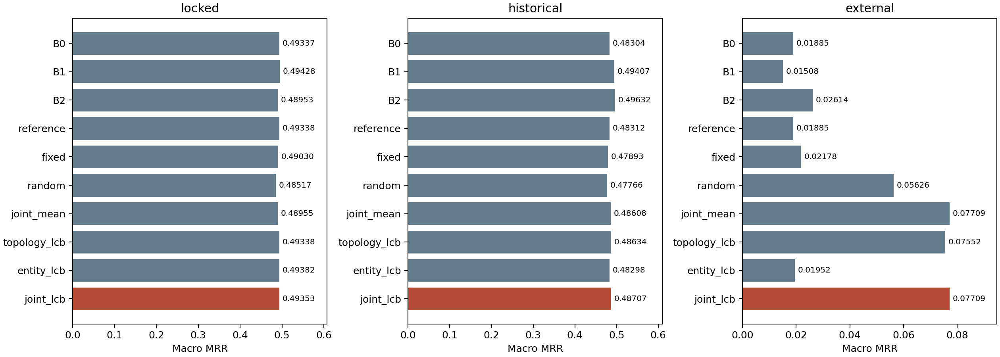
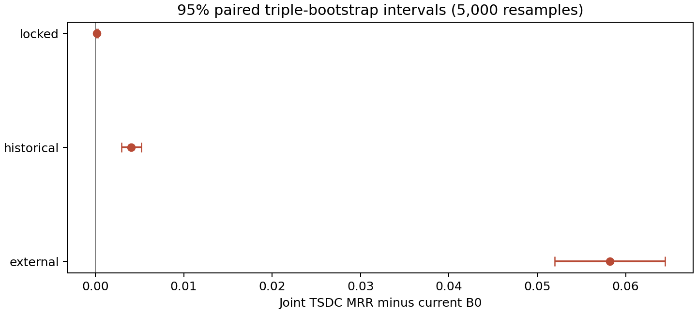
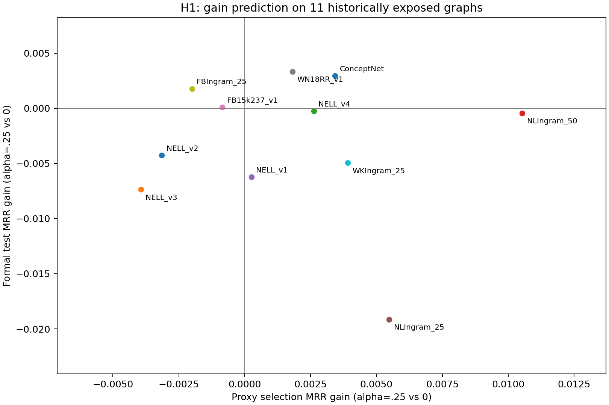

# 新阶段六：目标观测图自监督双层结构校准（TSDC）

本阶段完成目标观测图隔离、代理选择/确认两次独立前向、三源诊断、11图冻结协议复验、原始事实配对统计及基线数值回归。**研究决策：仅保留目标图自监督拓扑适配。** 拓扑单层在历史组和外部图相对同检查点参考的配对区间全正，锁定组则全部回退；实体单层在历史组显著下降，同符号固定对照也未支持条件度数比率的独特优势。保留拓扑加LCB作为受约束的研究分支，先重审代理分布，再在未暴露图谱复验，不继续扩大完整双层机制。

主TSDC的locked / historical / external MRR分别为 **0.493530 / 0.487073 / 0.077092**。相对本轮B0为 +0.000155 / +0.004031 / +0.058238；locked小差值不能作为稳定改进。historical仍低于旧B1/B2，external则超过三项基线，但训练种子SD为0.047684，收益并非所有检查点均等稳定。

正式协议为“无目标验证/测试标签、无目标梯度更新、允许目标观测图自监督选参”，与阶段五静态零样本协议不同。11张目标图均有历史暴露，结果不称新盲测。主结果固定代理种子6101，6102/6103仅作预注册稳健性诊断；从未按正式结果选择代理种子、训练种子或参数。

## 1. 研究问题与阶段五失败机制

阶段五固定结构策略跨图分化，T-4D/U-Cos 未在 locked/historical 建立对 B0 的稳定优势，旧 B2 也存在负迁移；原全局 HubCal 源选系数为0。阶段六分别检验 H1（代理预测拓扑收益）、H2（查询关系条件实体校准）、H3（双层与确认回退）。不训练新语义编码器，不启用 U-Cos，不重训 MOTIF，不使用目标梯度。

本轮选择的是**同一个 T-4D 检查点内部**的推理参数，不是从多个模型中择优。零调制参考保留该检查点全部关系层权重，gamma=0；不能把“关闭门控”命名为旧 B1。阶段五 T-4D 为 gate_only，骨干与官方权重逐位相同，但关系聚合后端仍须单独核验数值差异。

## 2. 代码审查和依赖恢复结果

基于私有归档提交 `173017b7c3a4d88edf73d2ce46b083a5fcb69354` 的独立 `stage6-tsdc` 分支开发，原始阶段五、历史目录及 sources 均只读。`EXTERNAL_DEPENDENCIES.json` 的222项依赖全部存在且 SHA256 匹配；旧 B1/B2 三种子六份完整权重、模型配置、种子和源选步全部恢复，哈希全部匹配，见 [依赖审查](results/dependency_audit.json)。

`common.downstream()` 会载入正式查询与 filtered truth，因而不用于适配。复用 `topology.extract()`、`plans.build_plan()`、CSR/加权算子与 MOTIF 模型；`evaluate.py` 的全候选、双向、严格过滤和悲观并列排名规则保持一致。头预测经 `negative_sample_to_tail()` 转为逆关系尾预测。旧 B2 的真实门控为 Fdim=1，T-4D 为 Fdim=4，分别恢复，不相互替代。

新入口参数化 stage5/history/source-root/official/observations，未运行旧 initialize.py 或旧 run.sh。沿用 Python3.9、PyTorch2.1.0+cu118、PyG2.4.0、Triton2.1.0 与 RTX3060 6GB，未新增依赖。原文件及独立副本完整性最终核验见 [verification.json](results/verification.json)。

## 3. 自监督代理任务与防泄漏验证

观测数据包闭合 schema 只有 edge_index、edge_type、n、R。GraIL 从 train_ind、Ingram 从 inference_graph 建立观测优先实体编号；关系 ID 取既有公开词表。合法候选实体数从既有**观测拓扑缓存的 degree 长度元数据**取得，明确区别于标签。ConceptNet 和源缓存只读取 numpy 延迟加载的观测成员，不读取 queries/alltrue。内部目标观测边的原始顺序和哈希与阶段五一致；正式评测再独立核对边、超边、查询顺序及过滤真值哈希。

选择器输入不含 valid/test、正式真值、查询分组或历史排名。数据类型不提供相应字段；文件访问审计额外拒绝这些资产。隔离测试在只能打开 sanitized observations 的条件下完成全部14图加载、划分与选择器执行。模型前向另在启用标签/排名文件拒绝规则的实际代理进程完成。

权重只从清洗后的 model_manifest.json 读取检查点、配置、种子和哈希；适配进程拒绝阶段五完整 frozen.json，避免其中正式查询分组派生元数据进入进程。

唯一正向事实为采样单位，固定2×2关系频率/端点度数分层，按种子轮转取样；优先保证端点剩余度数≥2，保留随机确定的生成森林及每个关系至少一条边。不放宽约束。重复正向事实去重，正逆边同步删除；选择和确认的事实在同一残余图中全部删除。联合删边后验证无直接/逆边泄漏、无新孤立实体、连通分量数和关系覆盖不变，实体全集不删减。

| 图谱 | 实体 | 关系 | 唯一观测事实 | 代理事实 | 选择 | 确认 | 实际掩码率 |
| --- | --- | --- | --- | --- | --- | --- | --- |
| NELLInductive_v2 | 2086 | 176 | 4586 | 256 | 153 | 103 | 0.055822 |
| NELLInductive_v3 | 3566 | 284 | 8048 | 256 | 153 | 103 | 0.031809 |
| NELLInductive_v4 | 2795 | 152 | 7073 | 256 | 153 | 103 | 0.036194 |
| NLIngram_50 | 2335 | 238 | 2576 | 78 | 46 | 32 | 0.030280 |
| NELLInductive_v1 | 225 | 28 | 833 | 124 | 74 | 50 | 0.148860 |
| NLIngram_25 | 2146 | 240 | 2230 | 23 | 13 | 10 | 0.010314 |
| FB15k237Inductive_v1 | 1093 | 360 | 1993 | 256 | 153 | 103 | 0.128450 |
| WN18RRInductive_v1 | 922 | 18 | 1618 | 242 | 145 | 97 | 0.149567 |
| FBIngram_25 | 4097 | 432 | 17147 | 256 | 153 | 103 | 0.014930 |
| WKIngram_25 | 3228 | 148 | 3391 | 66 | 39 | 27 | 0.019463 |
| ConceptNet100k_external | 78334 | 68 | 99997 | 256 | 153 | 103 | 0.002560 |

每个残余图重新执行拓扑提取和入射计划构建，四维标准化签名来自残余图。缓存以实体/关系规模、精确有序边及拓扑版本哈希寻址；记录图、样本、选择/确认子集和模型哈希，禁止跨划分误用。

开发期曾发现“预先评出全部确认配置”的实现过宽，在任何目标适配前修正为严格两次独立前向；此前4份源诊断保存在 source_diagnostics_before_confirmation_fix，不用于本报告结论。最终确认阶段仅评每个预声明独立消融在选择集胜出的单个候选及参考；未经选择的确认分数存为缺失值，不伪造为0，也不再调参。

## 4. 关系层测试时拓扑校准

alpha 网格固定0/.1/.25/.5/1。每个 alpha 都重新进行真实关系层及实体层前向，未插值最终得分。alpha=0 与同一检查点显式移除门控后的关系表示最大误差为0，非零 alpha 改变内部消息，完整网格有限；见 [数值测试](results/numeric_tests.json)。缓存关系表示只在同模型/图/alpha 调用内存在。

固定拓扑控制为 alpha=.25、gamma=0；旧 CV 控制在完整观测图上计算 `.15+.10*CV/(1+CV)`，不会从正式结果反推参数。关系层单独方法只在 gamma=0 的五点网格上选参，确认集只能接受该胜出候选或回退。

## 5. 查询条件实体得分校准

实现 `s - gamma*[log(1+d_global)-log(1+d_relation)]`，gamma 网格 −.03/−.01/0/.01/.03/.1。global_degree 为逆边增强图的入度，等于原始正向图总连接度；relation_degree 为候选作为转换后查询关系目标端的次数，两者求和口径一致。头预测使用 q+R/2 的逆关系。代理使用残余图度数，正式使用完整观测图度数。

gamma=0 直接返回原 tensor，逐位一致；无关系支持的候选保持有限；关系支持覆盖全部连接时该候选惩罚为0，不重复惩罚高度数真实实体。校准只修改输出候选得分，不修改传播、图、参数。原全局 HubCal 网格0/.001/.003/.01/.03/.1/.3亦保留，以独立实体层/联合消融评估，不把源选0改写成不存在对照。

主代理种子下各方法接受的系数方向如下。负系数不支持“应降低枢纽分数”的预设方向，须与模块独立收益和真实候选支持度合并解释：

| 方法 | 负系数 | 零系数 | 正系数 | 总数 |
| --- | --- | --- | --- | --- |
| entity_lcb | 9 | 24 | 0 | 33 |
| global_lcb | 0 | 33 | 0 | 33 |
| joint_lcb | 6 | 26 | 1 | 33 |
| joint_mean | 25 | 1 | 7 | 33 |

另在任何正式查询评测前登记 [matched_global_protocol.json](matched_global_protocol.json)，补充相同符号/相同系数的全局度数固定对照，覆盖原始B0、B1、B2及T-4D。该补充是在观察代理任务出现负系数选择后引入，属于**正式测试前登记的机制诊断**，不是最初源阶段的主协议，也不参与任何目标参数选择。它复用相同神经分数，只改变候选校准项，避免把负系数的作用误归因于关系条件化。全部五个非零系数结果都输出，未按正式结果挑最优系数；见 [degree_matched_control.csv](results/degree_matched_control.csv)。

以下是预先指定的正/负0.03切片，T-4D固定alpha=0，区间为条件公式减同系数全局公式；其他系数及四模型结果完整保留。这些探索性区间未作多重比较校正。

| 图组 | gamma | 条件MRR | 全局MRR | 条件减全局 | 下界 | 上界 |
| --- | --- | --- | --- | --- | --- | --- |
| locked | -0.030000 | 0.494539 | 0.496031 | -0.001492 | -0.002328 | -0.000655 |
| locked | 0.030000 | 0.492489 | 0.490328 | 0.002161 | 0.001324 | 0.003057 |
| historical | -0.030000 | 0.483161 | 0.484770 | -0.001609 | -0.002381 | -0.000878 |
| historical | 0.030000 | 0.483439 | 0.481827 | 0.001612 | 0.000957 | 0.002302 |
| external | -0.030000 | 0.019524 | 0.023265 | -0.003740 | -0.004672 | -0.002948 |
| external | 0.030000 | 0.018500 | 0.015058 | 0.003443 | 0.002459 | 0.004633 |

## 6. 置信回退机制

原始事实按60%/40%分选择/确认（取整后数量如上），两方向 RR 先在每事实内平均。主方法先在选择集比较30个条件校准联合配置；仅胜出者与固定参考进入该方法的确认比较。`LCB=mean(delta)-1.64*SE(delta)`，选择事实≥24、确认事实≥16且LCB>0才接受，否则回退alpha=gamma=0。所有网格、主代理种子、确认阈值和对照规则预先固定。

独立预声明的 topology/entity/global/joint-global 消融各有一次自己的确认，不根据它们的确认分数重选主方法。均值选参不使用确认回退；随机对照在30个联合配置上均匀抽取，随机流由图、训练种子、代理种子及6629的哈希固定。LCB只是代理上的经验保守启发式，不保证正式MRR不下降。

主代理种子33次选择中回退 26/33；全部三代理种子回退 82/99。

| 方法 | 回退次数 | 选择集已选参考 | 总次数 | 回退率 |
| --- | --- | --- | --- | --- |
| joint_lcb | 82 | 1 | 99 | 0.828283 |
| topology_lcb | 85 | 19 | 99 | 0.858586 |
| entity_lcb | 84 | 6 | 99 | 0.848485 |
| global_lcb | 99 | 36 | 99 | 1.000000 |
| joint_global_lcb | 86 | 5 | 99 | 0.868687 |

| 图谱 | 训练种子 | alpha | gamma | 回退 | 确认LCB |
| --- | --- | --- | --- | --- | --- |
| ConceptNet100k_external | 1024 | 1.000000 | -0.030000 | False | 0.033250 |
| ConceptNet100k_external | 2026 | 1.000000 | -0.030000 | False | 0.007094 |
| ConceptNet100k_external | 3407 | 0.500000 | -0.030000 | False | 0.002516 |
| FB15k237Inductive_v1 | 1024 | 0.000000 | 0.000000 | True | -0.002899 |
| FB15k237Inductive_v1 | 2026 | 0.000000 | 0.000000 | True | -0.002899 |
| FB15k237Inductive_v1 | 3407 | 0.000000 | 0.000000 | True | -0.007128 |
| FBIngram_25 | 1024 | 0.000000 | 0.000000 | True | -0.014682 |
| FBIngram_25 | 2026 | 0.000000 | -0.030000 | False | 0.000258 |
| FBIngram_25 | 3407 | 0.000000 | 0.000000 | True | -0.041624 |
| NELLInductive_v1 | 1024 | 1.000000 | 0.030000 | False | 0.010697 |
| NELLInductive_v1 | 2026 | 0.000000 | 0.000000 | True | -0.002079 |
| NELLInductive_v1 | 3407 | 0.500000 | -0.010000 | False | 0.000232 |
| NELLInductive_v2 | 1024 | 0.000000 | 0.000000 | True | -0.005545 |
| NELLInductive_v2 | 2026 | 0.000000 | 0.000000 | True | 0.000000 |
| NELLInductive_v2 | 3407 | 0.000000 | 0.000000 | True | -0.004387 |
| NELLInductive_v3 | 1024 | 0.000000 | 0.000000 | True | -0.071935 |
| NELLInductive_v3 | 2026 | 0.000000 | -0.030000 | False | 0.000638 |
| NELLInductive_v3 | 3407 | 0.000000 | 0.000000 | True | -0.019661 |
| NELLInductive_v4 | 1024 | 0.000000 | 0.000000 | True | -0.020043 |
| NELLInductive_v4 | 2026 | 0.000000 | 0.000000 | True | -0.024309 |
| NELLInductive_v4 | 3407 | 0.000000 | 0.000000 | True | -0.000738 |
| NLIngram_25 | 1024 | 0.000000 | 0.000000 | True | -0.165716 |
| NLIngram_25 | 2026 | 0.000000 | 0.000000 | True | -0.035038 |
| NLIngram_25 | 3407 | 0.000000 | 0.000000 | True | -0.034965 |
| NLIngram_50 | 1024 | 0.000000 | 0.000000 | True | -0.016145 |
| NLIngram_50 | 2026 | 0.000000 | 0.000000 | True | -0.002826 |
| NLIngram_50 | 3407 | 0.000000 | 0.000000 | True | -0.000492 |
| WKIngram_25 | 1024 | 0.000000 | 0.000000 | True | -0.003614 |
| WKIngram_25 | 2026 | 0.000000 | 0.000000 | True | -0.003614 |
| WKIngram_25 | 3407 | 0.000000 | 0.000000 | True | -0.003614 |
| WN18RRInductive_v1 | 1024 | 0.000000 | 0.000000 | True | -0.000288 |
| WN18RRInductive_v1 | 2026 | 0.000000 | 0.000000 | True | -0.000288 |
| WN18RRInductive_v1 | 3407 | 0.000000 | 0.000000 | True | -0.000288 |

全部99份目标选择及对照先写入不可覆盖 [frozen.json](frozen.json)，SHA256=`e6535ba979cedd249e727d9dd5c08533fc301ea25d7c99ff2cfbd0eb07d8390a`，然后新进程首次打开正式查询。报告及分析代码没有参数回写路径。

## 7. 主实验与全部对照

每个训练种子独立选参、独立预测后平均指标，没有分数集成。主代理种子固定6101；全部三代理种子的正式结果列于 [ablation.csv](results/ablation.csv)，不选最好种子。模型重跑110份，T-4D正式完整网格同时供冻结策略与事后机制诊断使用，禁止据此更新策略。B0仅官方固定检查点一份，SD记NA，不能声称三次独立训练方差为0。

| 图组 | 方法 | MRR | 种子SD | ΔB0 | Δ旧B1 | Δ旧B2 |
| --- | --- | --- | --- | --- | --- | --- |
| locked | joint_lcb | 0.493530 | 0.000254 | 0.000155 | -0.000746 | 0.004001 |
| locked | topology_lcb | 0.493383 | 0.000000 | 0.000009 | -0.000893 | 0.003854 |
| locked | entity_lcb | 0.493823 | 0.000000 | 0.000448 | -0.000453 | 0.004294 |
| locked | global_lcb | 0.493383 | 0.000000 | 0.000009 | -0.000893 | 0.003854 |
| locked | joint_global_lcb | 0.493383 | 0.000000 | 0.000009 | -0.000893 | 0.003854 |
| locked | joint_mean | 0.489555 | 0.003742 | -0.003820 | -0.004721 | 0.000026 |
| locked | reference | 0.493383 | 0.000000 | 0.000009 | -0.000893 | 0.003854 |
| locked | fixed | 0.490296 | 0.003826 | -0.003078 | -0.003980 | 0.000767 |
| locked | cv | 0.490528 | 0.003814 | -0.002846 | -0.003748 | 0.000999 |
| locked | random | 0.485174 | 0.008033 | -0.008200 | -0.009102 | -0.004355 |
| locked | B0 | 0.493374 | NA | 0.000000 | -0.000902 | 0.003845 |
| locked | B1 | 0.494276 | 0.000780 | 0.000902 | 0.000000 | 0.004747 |
| locked | B2 | 0.489529 | 0.001563 | -0.003845 | -0.004747 | 0.000000 |
| historical | joint_lcb | 0.487073 | 0.005964 | 0.004031 | -0.007001 | -0.009246 |
| historical | topology_lcb | 0.486343 | 0.004161 | 0.003302 | -0.007730 | -0.009976 |
| historical | entity_lcb | 0.482978 | 0.000000 | -0.000064 | -0.011096 | -0.013341 |
| historical | global_lcb | 0.483120 | 0.000000 | 0.000078 | -0.010954 | -0.013199 |
| historical | joint_global_lcb | 0.486343 | 0.004161 | 0.003302 | -0.007730 | -0.009976 |
| historical | joint_mean | 0.486083 | 0.007830 | 0.003041 | -0.007991 | -0.010236 |
| historical | reference | 0.483120 | 0.000000 | 0.000078 | -0.010954 | -0.013199 |
| historical | fixed | 0.478929 | 0.002996 | -0.004113 | -0.015145 | -0.017390 |
| historical | cv | 0.479583 | 0.002786 | -0.003459 | -0.014491 | -0.016736 |
| historical | random | 0.477663 | 0.007620 | -0.005378 | -0.016410 | -0.018655 |
| historical | B0 | 0.483042 | NA | 0.000000 | -0.011032 | -0.013277 |
| historical | B1 | 0.494074 | 0.001801 | 0.011032 | 0.000000 | -0.002245 |
| historical | B2 | 0.496319 | 0.002007 | 0.013277 | 0.002245 | 0.000000 |
| external | joint_lcb | 0.077092 | 0.047684 | 0.058238 | 0.062016 | 0.050950 |
| external | topology_lcb | 0.075517 | 0.046777 | 0.056663 | 0.060442 | 0.049375 |
| external | entity_lcb | 0.019524 | 0.000000 | 0.000670 | 0.004449 | -0.006618 |
| external | global_lcb | 0.018854 | 0.000000 | -0.000000 | 0.003779 | -0.007288 |
| external | joint_global_lcb | 0.075517 | 0.046777 | 0.056663 | 0.060442 | 0.049375 |
| external | joint_mean | 0.077092 | 0.047684 | 0.058238 | 0.062016 | 0.050950 |
| external | reference | 0.018854 | 0.000000 | -0.000000 | 0.003779 | -0.007288 |
| external | fixed | 0.021783 | 0.003273 | 0.002929 | 0.006708 | -0.004359 |
| external | cv | 0.021742 | 0.003233 | 0.002888 | 0.006666 | -0.004400 |
| external | random | 0.056256 | 0.023468 | 0.037402 | 0.041180 | 0.030114 |
| external | B0 | 0.018854 | NA | 0.000000 | 0.003779 | -0.007288 |
| external | B1 | 0.015076 | 0.002234 | -0.003779 | 0.000000 | -0.011066 |
| external | B2 | 0.026142 | 0.016011 | 0.007288 | 0.011066 | 0.000000 |

主方法逐图指标：

| 图谱 | MRR | 种子SD | Hits1 | Hits3 | Hits10 | ΔB0 | Δ旧B1 | Δ旧B2 |
| --- | --- | --- | --- | --- | --- | --- | --- | --- |
| NELLInductive_v2 | 0.563937 | 0.000000 | 0.452406 | 0.636364 | 0.767914 | 0.000003 | -0.000635 | 0.000336 |
| NELLInductive_v3 | 0.533234 | 0.001015 | 0.432613 | 0.590741 | 0.724588 | 0.000597 | 0.005540 | 0.010391 |
| NELLInductive_v4 | 0.503500 | 0.000000 | 0.381133 | 0.592951 | 0.710781 | 0.000022 | -0.004596 | -0.001958 |
| NLIngram_50 | 0.373448 | 0.000000 | 0.283469 | 0.414435 | 0.532596 | 0.000000 | -0.003294 | 0.007234 |
| NELLInductive_v1 | 0.694530 | 0.035495 | 0.633499 | 0.705638 | 0.858209 | 0.024471 | -0.030871 | -0.071314 |
| NLIngram_25 | 0.347794 | 0.000000 | 0.260081 | 0.375000 | 0.497984 | -0.000000 | -0.004167 | 0.018663 |
| FB15k237Inductive_v1 | 0.504709 | 0.000000 | 0.405109 | 0.569343 | 0.693431 | 0.000000 | -0.003713 | -0.003933 |
| WN18RRInductive_v1 | 0.680782 | 0.000000 | 0.623324 | 0.713137 | 0.777480 | 0.000000 | -0.004191 | -0.001663 |
| FBIngram_25 | 0.383555 | 0.000493 | 0.263383 | 0.432966 | 0.639550 | -0.000285 | -0.000631 | -0.001027 |
| WKIngram_25 | 0.311065 | 0.000000 | 0.221043 | 0.346596 | 0.493369 | -0.000000 | 0.001566 | 0.003796 |
| ConceptNet100k_external | 0.077092 | 0.047684 | 0.041250 | 0.075556 | 0.142083 | 0.058238 | 0.062016 | 0.050950 |

配对Bootstrap5000次。先按原始事实平均两个方向，再平均对应训练种子的RR差；区间反映固定检查点与固定图集条件下的查询抽样不确定性，不替代训练种子SD。图组区间每次在各图内独立重采样事实，再等权宏平均，未把图谱当11个独立同分布样本。

| 图组 | 方法 | 对照 | ΔMRR | 下界 | 上界 |
| --- | --- | --- | --- | --- | --- |
| locked | joint_lcb | reference | 0.000147 | 0.000052 | 0.000252 |
| locked | joint_lcb | fixed | 0.003234 | 0.001456 | 0.004937 |
| locked | joint_lcb | random | 0.008356 | 0.005932 | 0.010662 |
| locked | joint_lcb | joint_mean | 0.003975 | 0.002195 | 0.005785 |
| locked | joint_lcb | B0 | 0.000155 | 0.000060 | 0.000261 |
| locked | joint_lcb | B1 | -0.000746 | -0.002069 | 0.000509 |
| locked | joint_lcb | B2 | 0.004001 | 0.001997 | 0.005919 |
| locked | joint_lcb | topology_lcb | 0.000147 | 0.000052 | 0.000252 |
| locked | joint_lcb | entity_lcb | -0.000293 | -0.000503 | -0.000104 |
| locked | joint_lcb | joint_global_lcb | 0.000147 | 0.000052 | 0.000252 |
| locked | entity_lcb | reference | 0.000440 | 0.000156 | 0.000755 |
| locked | topology_lcb | reference | 0.000000 | 0.000000 | 0.000000 |
| locked | global_lcb | reference | 0.000000 | 0.000000 | 0.000000 |
| locked | joint_global_lcb | reference | 0.000000 | 0.000000 | 0.000000 |
| locked | joint_mean | reference | -0.003829 | -0.005646 | -0.002040 |
| locked | joint_mean | fixed | -0.000742 | -0.002167 | 0.000666 |
| locked | joint_mean | random | 0.004380 | 0.002673 | 0.006066 |
| locked | entity_lcb | global_lcb | 0.000440 | 0.000156 | 0.000755 |
| historical | joint_lcb | reference | 0.003953 | 0.002889 | 0.005058 |
| historical | joint_lcb | fixed | 0.008144 | 0.006203 | 0.010164 |
| historical | joint_lcb | random | 0.009409 | 0.007491 | 0.011464 |
| historical | joint_lcb | joint_mean | 0.000990 | -0.000125 | 0.002098 |
| historical | joint_lcb | B0 | 0.004031 | 0.002933 | 0.005182 |
| historical | joint_lcb | B1 | -0.007001 | -0.009634 | -0.004492 |
| historical | joint_lcb | B2 | -0.009246 | -0.012791 | -0.005788 |
| historical | joint_lcb | topology_lcb | 0.000729 | 0.000122 | 0.001373 |
| historical | joint_lcb | entity_lcb | 0.004095 | 0.003035 | 0.005214 |
| historical | joint_lcb | joint_global_lcb | 0.000729 | 0.000122 | 0.001373 |
| historical | entity_lcb | reference | -0.000142 | -0.000245 | -0.000040 |
| historical | topology_lcb | reference | 0.003223 | 0.002271 | 0.004254 |
| historical | global_lcb | reference | 0.000000 | 0.000000 | 0.000000 |
| historical | joint_global_lcb | reference | 0.003223 | 0.002271 | 0.004254 |
| historical | joint_mean | reference | 0.002963 | 0.001413 | 0.004541 |
| historical | joint_mean | fixed | 0.007154 | 0.005465 | 0.008958 |
| historical | joint_mean | random | 0.008420 | 0.006750 | 0.010126 |
| historical | entity_lcb | global_lcb | -0.000142 | -0.000245 | -0.000040 |
| external | joint_lcb | reference | 0.058238 | 0.051979 | 0.064444 |
| external | joint_lcb | fixed | 0.055309 | 0.049364 | 0.061291 |
| external | joint_lcb | random | 0.020836 | 0.017655 | 0.024069 |
| external | joint_lcb | joint_mean | 0.000000 | 0.000000 | 0.000000 |
| external | joint_lcb | B0 | 0.058238 | 0.051979 | 0.064444 |
| external | joint_lcb | B1 | 0.062016 | 0.055765 | 0.068352 |
| external | joint_lcb | B2 | 0.050950 | 0.044801 | 0.057061 |
| external | joint_lcb | topology_lcb | 0.001575 | 0.000800 | 0.002426 |
| external | joint_lcb | entity_lcb | 0.057568 | 0.051303 | 0.063780 |
| external | joint_lcb | joint_global_lcb | 0.001575 | 0.000800 | 0.002426 |
| external | entity_lcb | reference | 0.000670 | 0.000397 | 0.000975 |
| external | topology_lcb | reference | 0.056663 | 0.050456 | 0.062914 |
| external | global_lcb | reference | 0.000000 | 0.000000 | 0.000000 |
| external | joint_global_lcb | reference | 0.056663 | 0.050456 | 0.062914 |
| external | joint_mean | reference | 0.058238 | 0.051979 | 0.064444 |
| external | joint_mean | fixed | 0.055309 | 0.049364 | 0.061291 |
| external | joint_mean | random | 0.020836 | 0.017655 | 0.024069 |
| external | entity_lcb | global_lcb | 0.000670 | 0.000397 | 0.000975 |

| 图谱 | 对照 | ΔMRR | 下界 | 上界 |
| --- | --- | --- | --- | --- |
| NELLInductive_v2 | B0 | 0.000003 | -0.000017 | 0.000029 |
| NELLInductive_v2 | B1 | -0.000635 | -0.003246 | 0.002028 |
| NELLInductive_v2 | B2 | 0.000336 | -0.003199 | 0.003958 |
| NELLInductive_v3 | B0 | 0.000597 | 0.000210 | 0.001025 |
| NELLInductive_v3 | B1 | 0.005540 | 0.002304 | 0.008820 |
| NELLInductive_v3 | B2 | 0.010391 | 0.005860 | 0.015088 |
| NELLInductive_v4 | B0 | 0.000022 | -0.000000 | 0.000061 |
| NELLInductive_v4 | B1 | -0.004596 | -0.006989 | -0.002202 |
| NELLInductive_v4 | B2 | -0.001958 | -0.005140 | 0.001095 |
| NLIngram_50 | B0 | 0.000000 | -0.000000 | 0.000000 |
| NLIngram_50 | B1 | -0.003294 | -0.005452 | -0.001263 |
| NLIngram_50 | B2 | 0.007234 | 0.003279 | 0.011487 |
| NELLInductive_v1 | B0 | 0.024471 | 0.017915 | 0.031491 |
| NELLInductive_v1 | B1 | -0.030871 | -0.044569 | -0.017743 |
| NELLInductive_v1 | B2 | -0.071314 | -0.088679 | -0.054161 |
| NLIngram_25 | B0 | -0.000000 | -0.000336 | 0.000336 |
| NLIngram_25 | B1 | -0.004167 | -0.008129 | -0.000284 |
| NLIngram_25 | B2 | 0.018663 | 0.011882 | 0.025468 |
| FB15k237Inductive_v1 | B0 | 0.000000 | -0.000000 | 0.000000 |
| FB15k237Inductive_v1 | B1 | -0.003713 | -0.008291 | 0.000579 |
| FB15k237Inductive_v1 | B2 | -0.003933 | -0.010920 | 0.003522 |
| WN18RRInductive_v1 | B0 | 0.000000 | -0.000000 | 0.000000 |
| WN18RRInductive_v1 | B1 | -0.004191 | -0.007555 | -0.001107 |
| WN18RRInductive_v1 | B2 | -0.001663 | -0.007787 | 0.004029 |
| FBIngram_25 | B0 | -0.000285 | -0.000487 | -0.000085 |
| FBIngram_25 | B1 | -0.000631 | -0.001575 | 0.000336 |
| FBIngram_25 | B2 | -0.001027 | -0.002518 | 0.000391 |
| WKIngram_25 | B0 | -0.000000 | -0.000000 | 0.000000 |
| WKIngram_25 | B1 | 0.001566 | -0.000923 | 0.004036 |
| WKIngram_25 | B2 | 0.003796 | 0.000650 | 0.006948 |
| ConceptNet100k_external | B0 | 0.058238 | 0.052214 | 0.064581 |
| ConceptNet100k_external | B1 | 0.062016 | 0.055966 | 0.068299 |
| ConceptNet100k_external | B2 | 0.050950 | 0.044895 | 0.057040 |

为避免将不同选参策略的差异直接称为“协同”，另在实际冻结的联合参数上计算 `RR(a,g)-RR(a,0)-RR(0,g)+RR(0,0)`，先合并方向和训练种子，再按事实配对重采样。alpha或gamma为0时交互项按定义为0。此项仅为冻结后诊断，不选正式最优参数；正值表示该MRR尺度上的局部超加性，不证明普遍机制，且未校正多重比较。逐图结果见 [factorial_interaction.csv](results/factorial_interaction.csv)。

| 图组 | 排序交互差 | 下界 | 上界 |
| --- | --- | --- | --- |
| locked | 0.000000 | 0.000000 | 0.000000 |
| historical | 0.000708 | 0.000066 | 0.001388 |
| external | 0.000905 | 0.000099 | 0.001709 |

全部方法每图 Hits@1/3/10、种子SD及差值见 [graph_metrics.csv](results/graph_metrics.csv)，逐种子值见 [P0_metrics.csv](results/P0_metrics.csv)。多组区间未作多重比较校正，仅主方法及预注册比较具有优先解释地位，不能从大量探索性区间中挑正结果宣称整体显著。

## 8. 代理预测能力与参数稳定性

H1固定 alpha=.25 图级代理增益—正式增益 Pearson=-0.0713，Spearman=-0.0273，n=11。代理侧平均三训练种子×三代理种子**选择集**增益；正式侧平均三训练种子增益。不是使用正式最优配置倒推代理标签。每图四个非零alpha的相关性见 [within_graph_correlation.csv](results/within_graph_correlation.csv)，完整点见 [proxy_formal_correlation.csv](results/proxy_formal_correlation.csv)。

固定alpha=.25的图级收益点差符号一致 4/11。代理均值选出的**拓扑单层候选**对应正式收益的图级相关性为 {'pearson': 0.8360032361614244, 'spearman': -0.018181818181818184, 'n': 11}。以下候选全部在代理选择集确定，不计算或采用正式最优参数；每图汇总三训练种子×三代理种子。正点差次数不是显著或稳定有效次数，须结合区间及数值不确定性判断。完整逐次记录见 [selected_topology_prediction.csv](results/selected_topology_prediction.csv)。

选中候选的Pearson=0.836由ConceptNet的大增益强烈影响，Spearman=-0.018，并不支持跨图稳定排序。逐图四个非零alpha之间有8/11图呈正相关，但这不等于能判断非零调制是否优于alpha=0：例如NELL_v3的非零配置排序相近，代理均值选出的候选正式增益仍平均为负。确认回退因此是本轮主要的风险抑制环节，不能把原始代理均值当可靠的正式收益估计。

| 图谱 | 代理选择增益 | 正式候选增益 | 正式点差为正次数 | 诊断次数 |
| --- | --- | --- | --- | --- |
| NELLInductive_v2 | 0.005721 | -0.005647 | 0 | 9 |
| NELLInductive_v3 | 0.006304 | -0.007448 | 1 | 9 |
| NELLInductive_v4 | 0.013373 | -0.001597 | 5 | 9 |
| NLIngram_50 | 0.012640 | 0.000056 | 4 | 9 |
| NELLInductive_v1 | 0.008291 | 0.014491 | 6 | 9 |
| NLIngram_25 | 0.016277 | -0.009012 | 2 | 9 |
| FB15k237Inductive_v1 | 0.006520 | 0.001868 | 4 | 9 |
| WN18RRInductive_v1 | 0.005182 | 0.004353 | 6 | 9 |
| FBIngram_25 | 0.003282 | 0.001795 | 7 | 9 |
| WKIngram_25 | 0.010053 | -0.004651 | 0 | 9 |
| ConceptNet100k_external | 0.043723 | 0.056663 | 9 | 9 |

源图 alpha=.25 的图级相关性：{'pearson': -0.5494969769126892, 'spearman': -0.5, 'n': 3}。源诊断先于目标适配，使用合法源验证512条原始查询/图；源验证不作为目标选择的输入。三源代理共81份协议记录；相同残余图/模型/查询/配置只计算一次并核对哈希复用，不冒充独立重复。

这些源验证查询沿用阶段五选模数据，不能称为新的独立确认集。它们用于本阶段数值及代理可靠性诊断，未据此改变正式目标网格。

| 源图 | 名义率 | 实际率 | 实际样本 | 不同残余图 | 回退次数 | 总次数 |
| --- | --- | --- | --- | --- | --- | --- |
| fb15k237_train | 0.050000 | 0.000941 | 256 | 3 | 9 | 9 |
| fb15k237_train | 0.100000 | 0.000941 | 256 | 3 | 9 | 9 |
| fb15k237_train | 0.150000 | 0.000941 | 256 | 3 | 9 | 9 |
| wn18rr_train | 0.050000 | 0.002948 | 256 | 3 | 9 | 9 |
| wn18rr_train | 0.100000 | 0.002948 | 256 | 3 | 9 | 9 |
| wn18rr_train | 0.150000 | 0.002948 | 256 | 3 | 9 | 9 |
| codex_medium_train | 0.050000 | 0.001379 | 256 | 3 | 8 | 9 |
| codex_medium_train | 0.100000 | 0.001379 | 256 | 3 | 8 | 9 |
| codex_medium_train | 0.150000 | 0.001379 | 256 | 3 | 8 | 9 |

名义5%/10%/15%触及256上限时，同一种子划分可完全相同，因此**本轮不能据此证明实际掩码密度不敏感**。上限未偷偷扩大或缩小；实际率、残余图哈希及复用来源完整记录。参数稳定性按每图/训练种子跨三个代理种子的最终参数模式频率统计，见 [selection_stability.csv](results/selection_stability.csv)。三种子不是三个独立图谱，重叠代理事实也不能当独立重复。

为直接检验密度敏感性，另在三源图执行独立预注册的 [source_density_protocol.json](source_density_protocol.json)：实际按5%/10%/15%约束删边，固定同一批最多256条查询，只比较五个拓扑alpha，不进行选参。全部查询来自最低掩码率的隐藏事实，并验证属于更高率的隐藏池；因此查询顺序一致。该辅助诊断只使用训练种子1024和划分种子6101，不替代主协议三种子稳健性；结果见 [source_density_metrics.csv](results/source_density_metrics.csv)，相对5%时调制增益变化的配对区间见 [source_density_sensitivity.csv](results/source_density_sensitivity.csv)。它不改变目标代理构造或参数。

| 源图 | 实际删边率 | 零调制MRR | alpha025增益 |
| --- | --- | --- | --- |
| wn18rr_train | 0.049991 | 0.505546 | -0.002915 |
| wn18rr_train | 0.099994 | 0.464602 | 0.015379 |
| wn18rr_train | 0.149997 | 0.440690 | 0.016752 |
| codex_medium_train | 0.049999 | 0.271841 | 0.005001 |
| codex_medium_train | 0.099998 | 0.268501 | -0.001123 |
| codex_medium_train | 0.149997 | 0.265775 | -0.001791 |
| fb15k237_train | 0.049997 | 0.445624 | -0.006536 |
| fb15k237_train | 0.099998 | 0.410393 | -0.002397 |
| fb15k237_train | 0.149999 | 0.391233 | 0.004368 |

图谱共享数据来源/关系模式且有历史暴露，n=11较小，NELL/GraIL/Ingram版本非独立。删边代理偏向有剩余连接的频繁观测事实，与正式查询的生成、关系频率、实体支持和难度有分布差异。正相关也不证明逐图安全，负相关需要优先分析这种分布偏移，不能用正式结果扩网格寻找有利alpha。

以下分布诊断全部在冻结后的分析阶段计算：代理度数取残余图，正式度数取完整观测图；对所有隐藏代理事实统计，平均三个划分。JS距离使用以2为底的 Jensen–Shannon 距离（平方根形式），比较原始查询关系直方图。这些是分布差异证据，不能单独证明其造成了MRR变化。

| 图谱 | 关系分布JS距离 | 代理真候选关系零支持率 | 正式真候选关系零支持率 | 代理锚实体log度 | 正式锚实体log度 |
| --- | --- | --- | --- | --- | --- |
| NELLInductive_v2 | 0.440010 | 0.399089 | 0.309091 | 2.636654 | 2.630339 |
| NELLInductive_v3 | 0.501734 | 0.404297 | 0.328395 | 2.809817 | 2.837467 |
| NELLInductive_v4 | 0.440616 | 0.325521 | 0.250518 | 3.022905 | 2.981777 |
| NLIngram_50 | 0.518373 | 0.331159 | 0.419674 | 2.210431 | 1.890784 |
| NELLInductive_v1 | 0.085086 | 0.500000 | 0.500000 | 3.714944 | 3.786139 |
| NLIngram_25 | 0.678731 | 0.309026 | 0.447581 | 2.520917 | 1.801046 |
| FB15k237Inductive_v1 | 0.421346 | 0.513021 | 0.478102 | 2.016363 | 1.933721 |
| WN18RRInductive_v1 | 0.168720 | 0.347796 | 0.408847 | 1.625208 | 1.559584 |
| FBIngram_25 | 0.588623 | 0.451172 | 0.295749 | 2.755790 | 2.739143 |
| WKIngram_25 | 0.364640 | 0.321995 | 0.311671 | 2.109567 | 1.742272 |
| ConceptNet100k_external | 0.564533 | 0.322266 | 0.110000 | 3.510869 | 3.597591 |

## 9. 高度数枢纽与长尾子组

沿用阶段五固定 high_degree_hub、low_relation_frequency、low_incident_motif_support 掩码，仅在正式阶段加载；配对区间含空组/小样本状态见 [query_groups.csv](results/query_groups.csv)。这些组重叠，不将宏损失简单归因于一个组，更不把 high_degree_hub 掉分解释为“消息爆炸”。

另外区分：当前方向的查询锚实体高度数、真实候选高度数、最高分错误候选高度数且分数超过真实体。阈值在完整观测图正度实体上取90%分位，不用测试标签确定阈值；分组指标是在正式阶段计算。详见 [hub_candidate_groups.csv](results/hub_candidate_groups.csv)。

双向任务中，锚实体和真实候选的总体度数分布因头尾互换而相同，不能仅比较两组曝光比例。新分组的效应仅平均每个原始事实中满足该方向条件的RR差，再按事实配对Bootstrap；两个方向始终不作为独立样本。这样“预测高度数实体”与“以高度数实体为锚预测其他实体”的效果可以分别检验。

| 图谱 | 真实体关系支持log均值 | 最高错候选关系支持log均值 | 枢纽错候选超真率 | 条件支持与正确性Spearman | 固定gamma003增益 |
| --- | --- | --- | --- | --- | --- |
| NELLInductive_v2 | 1.518554 | 1.455472 | 0.303209 | -0.009139 | -0.002834 |
| NELLInductive_v3 | 1.605139 | 1.170398 | 0.256481 | 0.121793 | -0.001053 |
| NELLInductive_v4 | 1.886239 | 1.600010 | 0.364893 | 0.090228 | 0.000357 |
| NLIngram_50 | 1.053152 | 0.983014 | 0.423166 | 0.008267 | -0.000047 |
| NELLInductive_v1 | 2.460855 | 0.051727 | 0.000000 | 0.501879 | 0.000000 |
| NLIngram_25 | 0.891847 | 0.948979 | 0.371640 | -0.022704 | 0.001240 |
| FB15k237Inductive_v1 | 0.815534 | 0.843715 | 0.171533 | -0.038267 | -0.000947 |
| WN18RRInductive_v1 | 0.632499 | 0.560049 | 0.048257 | 0.056153 | -0.000450 |
| FBIngram_25 | 1.421258 | 1.481353 | 0.368877 | -0.030569 | 0.001180 |
| WKIngram_25 | 1.220002 | 1.387060 | 0.440318 | -0.057432 | 0.000889 |
| ConceptNet100k_external | 2.231062 | 0.120932 | 0.191250 | 0.792811 | -0.000354 |

支持—正确性相关性使用“真实候选 vs 模型最高分合法错误候选”的配对样本，不能解释为候选全集无偏正确概率，也不能把相关性写成度数的因果作用。固定alpha=0、gamma=.03是预注册网格中的事后解释性切片，**未作为正式最优系数**。真实高连接实体可能需要高得分；惩罚会带来收益或损害，方向由上述数据判别。

## 10. 统计局限、失败案例与研究决策

数值回归统一检查点、float32、eval模式、输入边/超边顺序、查询/filtered哈希与悲观并列规则。原官方关系层分段Triton核含 `tl.atomic_add`，存在浮点归约顺序敏感的代码路径；这给出可疑来源，**仅代码检查不能证明它是每个历史排名差异的唯一原因**。新拓扑关系聚合沿用阶段五加权CSR算子，不为改善结果切换后端。NELL_v1 当前同批重复与批量1/4/8的结果见 [b0_repeat.json](results/b0_repeat.json)，最高错候选分数、真分数与精确并列数保存于原始证据数组。

| 方法 | 比较份数 | 排名变化方向数 | 最大MRR绝对差 |
| --- | --- | --- | --- |
| B0 | 11 | 34 | 0.002960 |
| B1 | 33 | 111 | 0.001368 |
| B2 | 33 | 123 | 0.006465 |

当前B0相对阶段五最大图级MRR绝对差为0.002960。结合已知历史约0.001904的波动，低于相近量级的增益不称稳定方法改善。即使本轮短重复无变化，也不能证明历史跨运行问题已彻底消除；未恢复当时GPU调度及全部执行上下文。旧B1/B2恢复后亦逐方向对比旧排名，见 [baseline_reproducibility.csv](results/baseline_reproducibility.csv)。

普通NELL_v1复测发现批量相关排名差异后，又进行明确标记的事后数值定位：以全局固定顺序和批量2生成一次关系表示，并冻结这些表示，再只改变实体批量。关系层同批量2重复的最大表示差为 0，关系批量1与2的最大表示差为 0。

| 实体批量 | 相对首批量8排名变化 | MRR | ΔMRR | 真分数最大绝对差 |
| --- | --- | --- | --- | --- |
| 8 | 0 | 0.670059 | 0.000000 | 0.000000 |
| 8 | 0 | 0.670059 | 0.000000 | 0.000000 |
| 1 | 14 | 0.671894 | 0.001835 | 0.000005 |
| 4 | 26 | 0.670262 | 0.000204 | 0.000006 |

固定关系表示后，实体批量变化仍引起排名变化，因此实体传播/投影的批量数值路径也有贡献。 本次关系表示在重复及批量1/2下逐位一致，因此**不能把本次已复现的差异归因于关系层原子归约**；该静态风险仍存在，但这次证据指向实体分支。对首个已记录排名变化查询增加算子输入/输出追踪，最早差异为 `{'module': 'entity_model.layers.0.linear', 'input_max_abs_diff': 0.0, 'output_max_abs_diff': 1.9073486328125e-06}`，详见 [b0_operator_trace.json](results/b0_operator_trace.json)。该线性层首查询输入完全相同、权重未变而输出改变，将本次问题具体定位到批量形状敏感的实体线性计算；未取得具体CUDA库内核轨迹，不进一步宣称所有历史差异均来自同一个GPU核。诊断的关系表示和排名另存 [b0_fixed_relation_diagnostic.json](results/b0_fixed_relation_diagnostic.json)，从未用来替换主结果中首次固定B0运行，也未据此选择有利批量。阶段五原始资产和全部正式选择仍保持冻结。

适配与正式时间/显存（正式列为完整候选网格成本，不是只跑选中策略的部署延迟；图准备共享成本另列）：

| 图谱 | 每种子代理推理秒 | 共享图准备秒 | 每种子正式全网格秒 | 代理峰值GiB | 正式峰值GiB |
| --- | --- | --- | --- | --- | --- |
| NELLInductive_v2 | 13.718075 | 1.606653 | 36.254869 | 0.066649 | 0.072264 |
| NELLInductive_v3 | 14.740950 | 1.679437 | 62.679066 | 0.111156 | 0.160272 |
| NELLInductive_v4 | 13.313012 | 1.227301 | 47.305562 | 0.085301 | 0.151734 |
| NLIngram_50 | 9.337968 | 0.657510 | 36.504283 | 0.064599 | 0.124894 |
| NELLInductive_v1 | 8.124894 | 0.146847 | 10.935734 | 0.015036 | 0.025198 |
| NLIngram_25 | 7.181802 | 0.627827 | 33.451737 | 0.058759 | 0.068949 |
| FB15k237Inductive_v1 | 14.452179 | 1.143591 | 23.303343 | 0.054245 | 0.070520 |
| WN18RRInductive_v1 | 8.313311 | 0.146324 | 14.576161 | 0.028638 | 0.063275 |
| FBIngram_25 | 21.652484 | 4.754193 | 215.242700 | 0.179029 | 0.208848 |
| WKIngram_25 | 7.630287 | 0.444239 | 42.413061 | 0.078662 | 0.274587 |
| ConceptNet100k_external | 48.345377 | 7.407046 | 271.459680 | 1.659048 | 1.662685 |

局限包括：确认样本有限、代理样本约束偏差、上限造成名义掩码率饱和、单次固定随机策略、三个训练种子、版本图谱相关、未校正多重比较、历史目标暴露和后端数值不确定性。LCB未考虑全部设计选择及代理—正式分布偏移，不能当非劣效保证。

**Q1：代理是否预测正式收益？** 不能称为可靠的通用增益预测器；只有局部证据。 固定 alpha=.25 的图级 Pearson=-0.0713、Spearman=-0.0273（n=11）。结合逐图四个非零 alpha 的相关性表判断，不能仅凭一个相关系数宣称普遍预测能力；源图仅3个，相关性为描述性诊断。

**Q2：自监督选参是否优于固定和随机？** 本轮三个图组相对固定和随机对照的条件配对区间均全正，支持有收益。locked: Δ固定=+0.003234, Δ随机=+0.008356; historical: Δ固定=+0.008144, Δ随机=+0.009409; external: Δ固定=+0.055309, Δ随机=+0.020836。区间见上表；点估计优势不等于稳定优势。

**Q3：查询条件实体校准是否有独立收益？** 没有建立稳定的跨组独立收益。locked: 实体单层Δ参考=+0.000440 [+0.000156, +0.000755]; historical: 实体单层Δ参考=-0.000142 [-0.000245, -0.000040]; external: 实体单层Δ参考=+0.000670 [+0.000397, +0.000975]。区间见上表；点估计优势不等于稳定优势。

**Q4：双层是否优于两个单独模块？** 存在历史组/外部图的局部协同，但没有稳定优于两个单模块；锁定组联合方法低于实体单层，差值区间全负。locked: Δ拓扑单层=+0.000147, Δ实体单层=-0.000293; historical: Δ拓扑单层=+0.000729, Δ实体单层=+0.004095; external: Δ拓扑单层=+0.001575, Δ实体单层=+0.057568。区间见上表；点估计优势不等于稳定优势。

**Q5：是否超过全部强基线？** 没有建立三个图组上全面超过 B0、旧 B1、旧 B2 的优势。完整基线权重已恢复，正式对照不存在缺失；历史排名与当前重跑的数值差异另列。

**Q6：主要失败机制？** 主要限制是代理分布与选优偏差，以及实体校准方向/条件化机制的不稳定；关系层在历史组和ConceptNet保留了实质收益，不能判为完全无效。固定alpha图级收益符号仅4/11一致，三源实际删边密度均使增益变号；同符号负gamma全局固定校准又优于条件公式。数值问题已在固定关系表示下定位到实体分支的批量计算路径，会影响小差值，但不能解释ConceptNet约0.058的增益。各因素尚未由完全独立干预分解，不能强称唯一原因。

**最终研究决策：仅保留目标图自监督拓扑适配。** 拓扑单层在历史组和外部图相对同检查点参考的配对区间全正，锁定组则全部回退；实体单层在历史组显著下降，同符号固定对照也未支持条件度数比率的独特优势。保留拓扑加LCB作为受约束的研究分支，先重审代理分布，再在未暴露图谱复验，不继续扩大完整双层机制。 此决策基于上述冻结结果，不把预期收益写为已观察收益；新机制或新代理分布的下一轮验证应另立协议，不能修改本轮目标参数。

完整性核验通过：原阶段五1181个文件哈希保持不变；历史资产10项保持不变；308份排名工件核验通过；目标梯度更新0次。复现步骤见 [README](README.md)。
