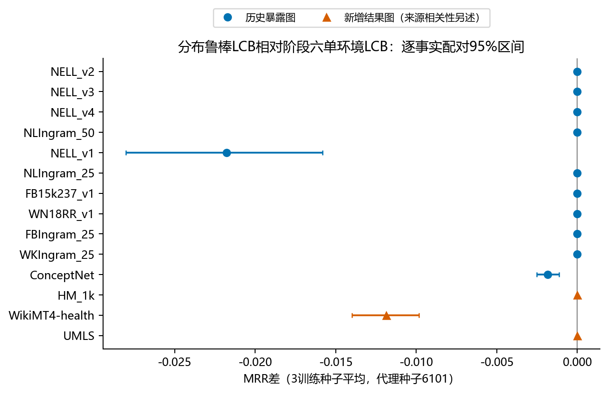
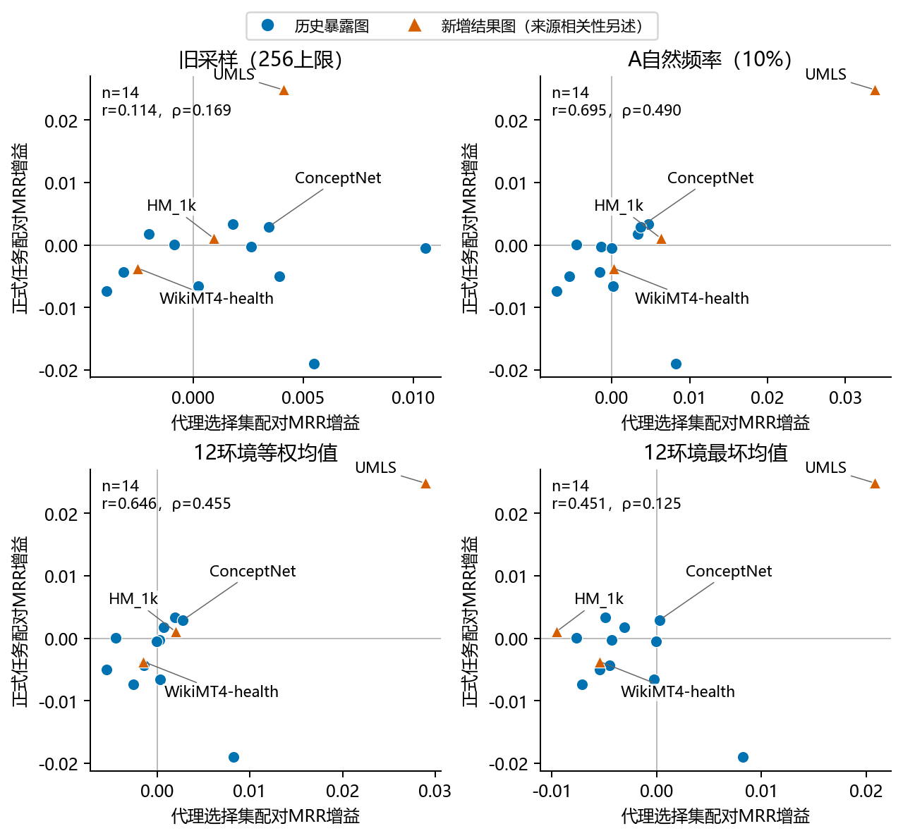
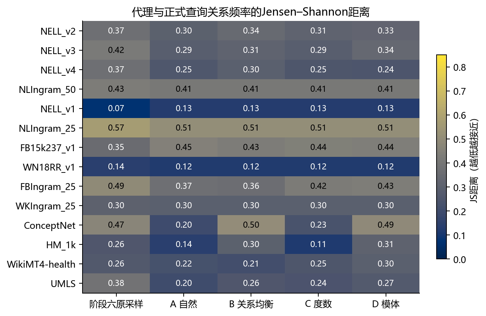
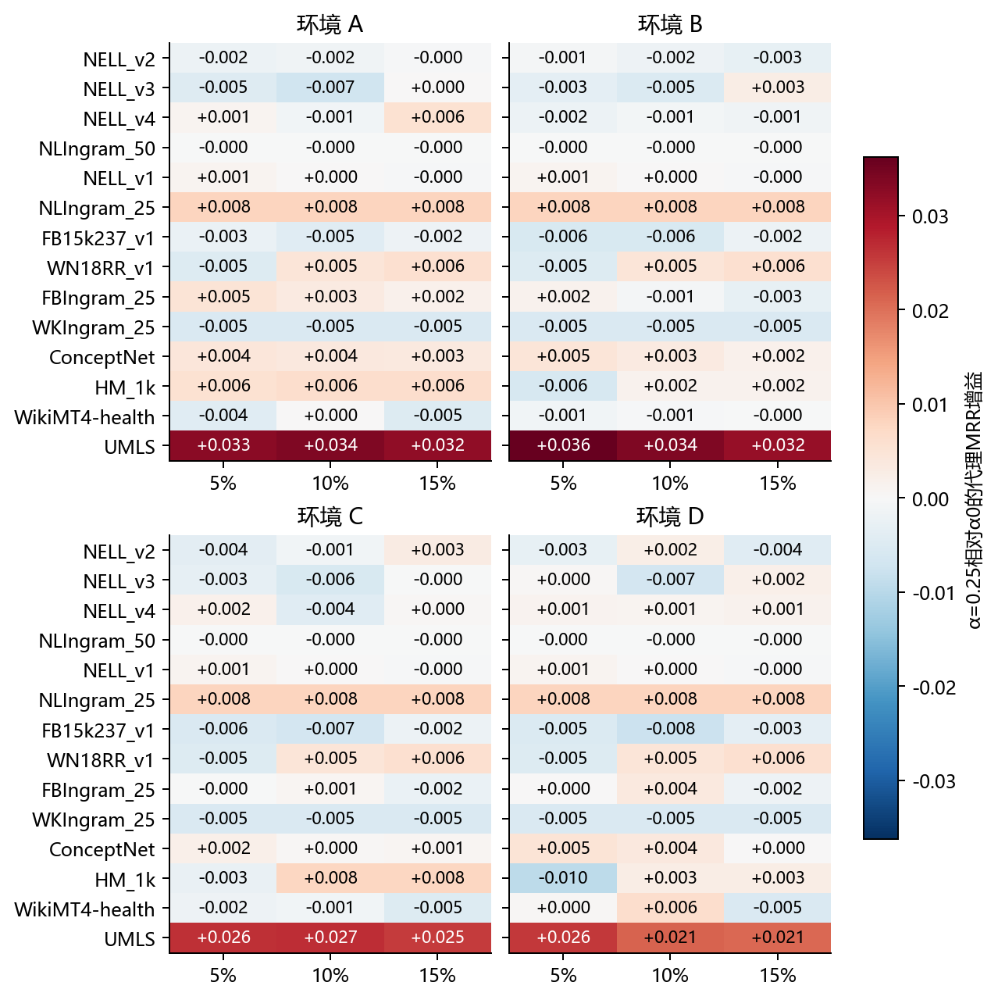
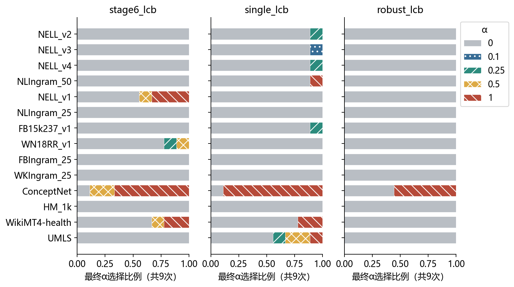

# 阶段七：分布鲁棒的目标观测图自监督拓扑适配

本报告仅陈述实际运行结果。所有排名来自既有检查点的真实前向，不进行梯度更新、实体度数校准、语义融合或分数插值。

完成状态：passed；正式评测14图/140个模型运行；封存126组目标选择；核对1987份阶段五/六原始文件，内容哈希均保持不变。

研究决策：**B. 保留单环境LCB，放弃本轮复杂多环境选择器**。12环境鲁棒LCB没有优于单环境LCB：主代理种子下14图为0胜、3负、11平，新增三图全部退回α0。多环境均值的相关性点估计改善依赖UMLS高收益点。保留单环境LCB作为低复杂度研究基线，不把它宣称为已建立普遍跨图优势的方法。

## 1. 研究问题与阶段六审计

检验H1单分布代理不足、H2多分布覆盖、H3鲁棒选择更稳定、H4结构分布与掩码密度影响迁移。阶段六11张图均是历史暴露目标，不能视为本阶段的新盲测。阶段六固定α0.25的图级Pearson约−0.071、Spearman约−0.027，不能据ConceptNet单点的巨大收益认定一般预测能力。旧双层协同和实体校准没有稳定证据，本阶段停止扩展这两项。

阶段六实际掩码率差异有两个独立原因：256条上限使ConceptNet为256/99997≈0.256%，NELL-v1则为124/833≈14.886%；生成森林、保留关系覆盖及逐步剩余度数≥2的约束进一步限制稀疏图。原2×2桶轮转对桶近似等权，会改变自然事实分布；森林保护及端点约束又偏向可删除的环和较高连接度上下文。正式查询本身的关系分布、词表与图规模，及删除后拓扑变化，是另外三类来源，不能全归因于掩码率。

已逐表审计阶段六要求的代理关联、选择预测、密度、稳定性、消融、交互项与完整性结果；见 [审计记录](results/stage6_audit.json)。阶段六原报告、冻结选择及结果没有重写。

## 2. 接口复用、检查点与新增数据

观测加载复用封闭的ObservedGraph；关系超图和四维签名复用topology.extract，CSR复用plans.build_plan；模型加载复用已核验的阶段六适配器。正式查询仅由独立进程在全局封存后读取，并对历史图核对阶段五查询、观测图、超图及过滤真值哈希。没有调用common.downstream把正式标签交给选择器，也没有运行initialize.py。

B0为官方motif_3g；T-4D为阶段五gate_only检查点；旧B1/B2为已恢复的真实历史权重与实现。T-4D的α0是同一检查点关闭额外拓扑残差，不能叫作旧B1。每一训练种子独立校准，不在不同检查点之间进行测试时模型选择。完整路径、源选择记录与SHA见只读 [模型清单](../stage6/model_manifest.json)。

历史暴露检索检查了2613份研究文件；仅有2处新候选名称命中，均须结合证据解释，不能把官方数据目录中的名称视为实际旧实验。早期已做结构审计的Metafam、ILPC Small及若干WikiTopics明确不标为全新目标。

| 新增候选 | 来源 | 实体 | 含逆关系数 | 唯一观测事实 | 资源预检 | 观测事实与预训练语法重合 |
| --- | --- | --- | --- | --- | --- | --- |
| HM_1k_new | WordNet | 9899 | 22 | 18417 | compatible_topology | 0 |
| WikiTopicsMT4_health_new | Wikidata | 10000 | 40 | 15337 | compatible_topology | 80 |
| AristoV4_external_new | Aristo-science | 42016 | 3186 | 242567 | resource_failure | 0 |
| UMLS_external_new | UMLS-biomedical | 135 | 92 | 5216 | compatible_topology | 0 |

HM-1k、WikiTopics-MT4 health来自官方归纳基准目标图，但分别与WordNet、Wikidata/CoDEx来源相关；官方归纳/OOKB类别本身也不等于源图与推理图实体完全不相交。Aristo和UMLS是新的外部知识来源，采用原公开转导划分上的跨图零样本评测，不能改称严格实体完全不相交的标准归纳基准。因此不宣称取得了三个完全独立、从未暴露的标准归纳来源。WikiTopics观测事实存在预训练直接重合；其他图的字符串零重合也不能证明语义独立。正式查询的事后质量与重合审查见 [逐图质量](results/new_graph_quality.csv)。

| 新图 | 测试事实 | 重复 | 直接观测重合 | 同谓词反向观测 | 预训练语法重合 |
| --- | --- | --- | --- | --- | --- |
| HM_1k_new | 476 | 0 | 0 | 0 | 0 |
| WikiTopicsMT4_health_new | 1703 | 0 | 0 | 397 | 7 |
| UMLS_external_new | 661 | 0 | 0 | 97 | 0 |

同谓词反向事实(t,r,h)是另一条合法观测事实，不等同于本轮必须同步删除的显式逆关系边(t,r+R/2,h)。上述反向结构和预训练重合按原公开划分保留，只作封存后的数据质量诊断，不删除正式查询、不重选参数，也不把它们混称为本轮选择器读取测试标签。

发布包源图/同主题转导邻图的额外来源审查如下；这些图从未用于阶段七训练或目标选择，且这项审查不读取正式查询。必须区分原MT4训练混合图和运行时同主题转导邻图。

| 目标 | 来源图版本 | 源实体 | 推理实体 | 实体交集 | 关系交集 | 事实交集 |
| --- | --- | --- | --- | --- | --- | --- |
| HM_1k_new | official_Hamaguchi_source | 36237 | 9899 | 7971 | 11 | 0 |
| WikiTopicsMT4_health_new | runtime_health_transductive_sibling | 10000 | 10000 | 3710 | 20 | 7003 |
| WikiTopicsMT4_health_new | published_MT4_mixture | 10000 | 10000 | 3 | 0 | 0 |

数据参考：[INDIGO官方数据](https://github.com/shuwen-liu-ox/INDIGO)、[MOTIF官方数据接口](https://github.com/HxyScotthuang/MOTIF)、[UMLS公开数据说明](https://pykeen.readthedocs.io/en/stable/_modules/pykeen/datasets/umls.html)、[Aristo-v4原分发](https://zenodo.org/records/5942560)。下载哈希、固定提交、来源和版本限制均随观测清单保存。

## 3. 多分布代理、密度与隔离

以唯一原始正向事实为单位，保留随机生成森林、各观测关系至少一条事实及逐步剩余端点度数2，绝不偷偷放宽。同步删除显式逆边和被掩码事实的全部重复拷贝，保留未掩码事实的原有重复数；实体和关系全集保持不变。按5%、10%、15%形成嵌套物理掩码，不再以256限制删除数量。查询预算min(192,max(64,ceil(2√E)))仅限制评估查询，不能限制物理掩码；不足记录实际数量。

目标适配前发现并修正了沿用阶段六时的残余图全局去重：HM有221条、ConceptNet有3条重复前向记录，不能在未掩码时额外删除。修正仅在阶段七生效；三个源图无重复且逐残余图输入哈希验证完全相同。相关新图缓存已重建并封存验证，见 [重复拷贝核验](results/proxy_multiplicity_verification.json)。原阶段六采样基线保留其原去重行为，因此该基线与新方法在相关图上的差异不能全归因于多环境；新单环境和新多环境对照共享修正后的构图。

四环境共用物理残余图与共同5%隐藏查询池：A受约束自然频率，B关系均衡，C观测正事实两端度数3×3分层，D正逆关系合并模体入射支持三分层。这样控制图变化，尽量只比较查询分布。A不是不受约束的原始关系精确配额；B也无法凭空恢复被森林或稀有关系约束保护的事实。全部密度使用相同查询池，所有选择与确认事实均隐藏；全局60%/40%事实池互斥，防止一个环境的确认事实进入另一个环境选择。各环境查询数量匹配。

每个残余图重新计算超边、模体、四维签名、CSR及观测结构统计。全图签名仅用于定义采样分层，绝不作为残余模型的签名。缓存以真实残余边、类型、n/R及算子版本标识，查询、模型权重和配置另有哈希。约束导致不同名义密度对应同一真实掩码时，明确保留该别名，不伪造密度变化。

另对每个图和代理种子重放森林保护步骤，核对被保护事实数量及其与隐藏集合完全互斥；逐组报告关系覆盖、关系分布JS距离、端点度数、关系频率和低度数端点比例，量化约束带来的分布限制。该审查只读观测图，不改变冻结采样，见 [约束偏差表](results/observation_constraint_bias.csv) 和 [重放核验](results/observation_constraint_bias_verification.json)。

| 图谱 | 5%真实率 | 10%真实率 | 15%真实率 | 每环境选择/确认（种子6101） |
| --- | --- | --- | --- | --- |
| NELLInductive_v2 | 0.049935 | 0.099869 | 0.149804 | 81/55 |
| NELLInductive_v3 | 0.049950 | 0.099901 | 0.149975 | 108/72 |
| NELLInductive_v4 | 0.049908 | 0.099958 | 0.149866 | 101/68 |
| NLIngram_50 | 0.031832 | 0.031832 | 0.031832 | 49/33 |
| NELLInductive_v1 | 0.049220 | 0.099640 | 0.148860 | 24/17 |
| NLIngram_25 | 0.011211 | 0.011211 | 0.011211 | 15/10 |
| FB15k237Inductive_v1 | 0.049674 | 0.099849 | 0.149523 | 54/36 |
| WN18RRInductive_v1 | 0.049444 | 0.099506 | 0.149567 | 48/32 |
| FBIngram_25 | 0.049980 | 0.099959 | 0.149997 | 115/77 |
| WKIngram_25 | 0.019758 | 0.019758 | 0.019758 | 40/27 |
| ConceptNet100k_external | 0.049991 | 0.099993 | 0.149994 | 115/77 |
| HM_1k_new | 0.049954 | 0.093555 | 0.093555 | 115/77 |
| WikiTopicsMT4_health_new | 0.049945 | 0.099954 | 0.149964 | 115/77 |
| UMLS_external_new | 0.049847 | 0.099885 | 0.149923 | 87/58 |

选择器在文件访问拦截下运行，禁止正式查询、历史排名、下载包、旧结果和原始数据目录。代理过滤只用合法完整观测事实，包含被隐藏代理正例；没有正式valid/test真值。21项CPU回归、实际图泄漏断言和GPU机制检查结果见 [完整性核验](results/verification.json) 及 [测试日志](results/tests.log)。

## 4. 拓扑选择与独立确认

α固定为{0,0.1,0.25,0.5,1}，逐配置执行真实关系层与实体层前向。主要方法在选择集最大化12个“环境×密度”的最小LCB，κ=1.64；平局取较小α。仅各预声明方法的一个最终候选和α0进入确认；先封存候选计划，再计算确认，不重试。任一相关确认环境LCB≤0或选择/确认不足24/16事实，则回退α0。独立消融方法可复用各自已预声明候选的真实前向，不能把确认集当新搜索网格。

对每个原始事实，$RR_i(\alpha)=\frac12(1/r_{i,tail}+1/r_{i,head})$，$\Delta_{ki}=RR_i(\alpha)-RR_i(0)$；$LCB_k=\overline\Delta_k-1.64\,s(\Delta_k)/\sqrt{n_k}$，样本标准差使用自由度$n_k-1$。主方法先最大化选择集的$\min_k LCB_k$，再要求同一候选在确认集全部相关环境的LCB均大于0。加权均值确认使用环境LCB的加权和，即保守地使用$\sum_k w_k SE_k$，不将重叠环境当成独立样本来缩小误差。

同时保留阶段六原采样的均值/LCB、A在10%下的均值/LCB、固定α0.25、α0、随机α、等权/样本权重/长尾权重（B权重2）均值、最坏均值、仅四环境10%和仅A三密度等控制。等样本量下样本量权重理应接近等权，这是匹配设计的结果。LCB只是代理上的经验风险控制，不能保证正式MRR不下降。

匹配样本数控制中，样本量加权相对等权的最终α在126组中有0组不同；不能把两者近似相同的结果解释为两份独立验证，也不能据此推断在不等样本量设计下仍无权重影响。

规则冻结UTC：2026-11-03T16:38:32.180338+00:00；全部选择封存UTC：2026-11-03T19:21:41.698015+00:00。最终冻结SHA256：`dbabe597342dac57fe4c216091f21e079653073bd543c292e3effbf2603c8306`。正式输入的打开标记均晚于这一全局封存。

封存后首次正式启动因历史清单的Windows反斜杠路径在WSL中不可解析而中止，尚未打开正式查询。随后使用独立path_compat启动器，仅在SHA文件读取边界规范化路径分隔符，先核验全部历史文件，再进入原正式程序；所有冻结代码及选择记录保持原字节。兼容修复记录见 [路径核验](results/path_compat_formal.json)，不涉及参数、模型、评估公式或结果筛选。

## 5. 数值稳定性与统一基线回归

历史诊断中，原路径相对batch1的最大分数差为3.81469727e-06；固定逐查询GEMM形状后，所测四模型、batch1/2/4/8的最大差为0。源图也逐一验证了批量一致性、α0与同检查点去门控输出一致、非零α改变关系表示及阶段五标准双向排名接口的一致性。

最终各方法统一采用FP32、关闭TF32、逐查询实体线性投影和固定全局关系编号对；没有按MRR选择批量。保留悲观>=并列排名，不做分数舍入或容差并列。TF32、FP64/BF16局部投影及自动混合精度只是独立诊断，其支持情况和误差如实保存在 [GPU检查](results/gpu_checks.json)；不能混同为全模型FP64。

| 路径 | batch | 对原batch1排名变化 | 最大分数差 | 错误候选精确并列 | MRR |
| --- | --- | --- | --- | --- | --- |
| native_fp32 | 1 | 0 | 0 | 188 | 0.671894 |
| native_fp32 | 2 | 0 | 0 | 188 | 0.671894 |
| native_fp32 | 4 | 18 | 1.9073486e-06 | 244 | 0.670262 |
| native_fp32 | 8 | 14 | 5.4836273e-06 | 226 | 0.670059 |
| querywise_fp32 | 1 | 0 | 0 | 188 | 0.671894 |
| querywise_fp32 | 2 | 0 | 0 | 188 | 0.671894 |
| querywise_fp32 | 4 | 0 | 0 | 188 | 0.671894 |
| querywise_fp32 | 8 | 0 | 0 | 188 | 0.671894 |

正式B0、真实B1/B2及T-4D均在这条共同数值路径上重跑。与阶段六旧数值路径的差异列于 [完整基线回归](results/numeric_baseline_regression.csv)，旧阶段六冻结α在新路径上的重放列于 [选择重放](results/stage6_frozen_selection_replay.csv)。这些数值变化不能计入拓扑适配收益。固定样本批量一致不等于所有设备、原子归约和输入都已获严格确定性证明。

利用名义密度因约束而产生的相同实际残余图，额外检查450组相同图、相同查询及α的重复排名，方向排名变化总数为0。这些是相关输入上的排名重复性检查，不是独立泛化样本；此处没有保存分数，不能由排名相同推断逐分数完全一致。见 [相同输入复验](results/aliased_graph_repeatability.csv)。

NELL-v1的α0/B0额外事后诊断检查了93个共同权重/缓冲张量，不相同的有0个；在固定关系对下，首个关系层线性输出最大误差为0.00207519531，最终关系表示最大误差为3.93390656e-06。另把T-4D关系前向临时替换为官方关系前向，保持同一权重、实体前向、精度与排名定义，只作路径隔离诊断：

| 诊断路径 | MRR | 对B0排名变化 | 对B0最大分数误差 | 对本族冻结α0排名变化 |
| --- | --- | --- | --- | --- |
| B0 | 0.671894 | 0 | 0 | 0 |
| T4_CSR_alpha0 | 0.669460 | 13 | 1.71661377e-05 | 0 |
| T4_official_relation_forward | 0.671894 | 0 | 0 | 13 |

按关系层顺序的线性输出最大误差：0.00207519531, 8.89880371, 18.7588501, 25.1032085, 29.3020515, 52.3259888。

此检查在全部正式运行之后执行，没有替换任何冻结排名或重新选择α。α0保留阶段五CSR关系归约实现，官方B0使用其原关系实现；逐查询实体GEMM修复不能自动保证两条关系层路径逐位一致。路径诊断及其复现命令见 [α0数值审查](results/alpha0_relation_kernel_audit.json) 和README。

## 6. 源图机制与预测可靠性

先完成三个源图×三个代理划分，共9个机制组合；此部分使用训练种子1024，另以原合法源验证前512事实作标准双向评测。源图训练种子不确定性不由这9个重复冒充，正式目标实验另运行三个既有训练种子。源代理密度、环境、α的完整指标见 [源代理表](results/source_proxy_metrics.csv)，代理—源验证对应见 [源预测表](results/source_proxy_validation_predictions.csv)。

这些源验证数据曾用于旧阶段检查点选择，属于机制和设计诊断，不是新的独立泛化证据；其固定α配对区间见 [源验证统计](results/source_validation_bootstrap.csv)。

| 源图 | α0验证MRR | 固定0.25 | 阶段六LCB | A/10% LCB | 鲁棒LCB | 随机α均值 |
| --- | --- | --- | --- | --- | --- | --- |
| wn18rr_train | 0.531226 | 0.531572 | 0.531226 | 0.531226 | 0.531226 | 0.528472 |
| codex_medium_train | 0.379618 | 0.386714 | 0.379618 | 0.379618 | 0.379618 | 0.373284 |
| fb15k237_train | 0.353325 | 0.358043 | 0.353325 | 0.353325 | 0.353325 | 0.350625 |

## 7. 正式主实验、强基线与消融

以下主结果使用事先指定代理种子6101，MRR对三个既有训练种子取均值；B0只有一份官方检查点。另两代理种子用于稳健性诊断，不据正式结果挑选最好划分。所有方法的Hits和训练种子明细见 [完整逐图表](results/P0_metrics.csv)、[逐种子表](results/per_seed_metrics.csv)。

这三个种子对应既有源端门控或关系继续训练，不是三个独立预训练MOTIF骨干。阶段七没有重新训练任何检查点。

同检查点α0参考与官方B0分别列出；两者不能因都关闭额外调制而直接视为完全相同的模型/算子路径。拓扑模块的配对增益一律相对同检查点α0计算，对强基线的差值另列。

| 图谱 | B0 | 旧B1 | 旧B2 | 同检查点α0 | 固定α0.25 | 阶段六采样·LCB | A/10%·LCB | 12环境等权均值+确认 | 12环境鲁棒LCB |
| --- | --- | --- | --- | --- | --- | --- | --- | --- | --- |
| NELLInductive_v2 | 0.563942 | 0.564577 | 0.563603 | 0.563931 | 0.559668 | 0.563931 | 0.563329 | 0.563931 | 0.563931 |
| NELLInductive_v3 | 0.532634 | 0.527699 | 0.522842 | 0.532629 | 0.525283 | 0.532629 | 0.532629 | 0.532629 | 0.532629 |
| NELLInductive_v4 | 0.503515 | 0.508108 | 0.505465 | 0.503496 | 0.503239 | 0.503496 | 0.503496 | 0.504483 | 0.503496 |
| NLIngram_50 | 0.373448 | 0.376741 | 0.366213 | 0.373448 | 0.373002 | 0.373448 | 0.377897 | 0.377897 | 0.373448 |
| NELLInductive_v1 | 0.671894 | 0.724453 | 0.764195 | 0.669460 | 0.662857 | 0.691244 | 0.669460 | 0.669460 | 0.669460 |
| NLIngram_25 | 0.347682 | 0.351998 | 0.329167 | 0.347682 | 0.328694 | 0.347682 | 0.347682 | 0.347682 | 0.347682 |
| FB15k237Inductive_v1 | 0.504709 | 0.508423 | 0.508642 | 0.504709 | 0.504796 | 0.504709 | 0.507396 | 0.504709 | 0.504709 |
| WN18RRInductive_v1 | 0.680782 | 0.684973 | 0.682445 | 0.680782 | 0.684106 | 0.680782 | 0.680782 | 0.680782 | 0.680782 |
| FBIngram_25 | 0.383840 | 0.384185 | 0.384582 | 0.383840 | 0.385610 | 0.383840 | 0.383840 | 0.383840 | 0.383840 |
| WKIngram_25 | 0.311065 | 0.309499 | 0.307269 | 0.311065 | 0.306117 | 0.311065 | 0.311065 | 0.311065 | 0.311065 |
| ConceptNet100k_external | 0.018854 | 0.015076 | 0.026142 | 0.018854 | 0.021783 | 0.075517 | 0.073683 | 0.073683 | 0.073683 |
| HM_1k_new | 0.063457 | 0.061996 | 0.061682 | 0.063455 | 0.064529 | 0.063455 | 0.063455 | 0.063455 | 0.063455 |
| WikiTopicsMT4_health_new | 0.626438 | 0.636450 | 0.633501 | 0.626291 | 0.622590 | 0.638146 | 0.638146 | 0.626291 | 0.626291 |
| UMLS_external_new | 0.655150 | 0.652440 | 0.724263 | 0.655150 | 0.680004 | 0.655150 | 0.688641 | 0.695063 | 0.655150 |

鲁棒LCB的逐图指标与相对真实强基线的点差：

| 图谱 | MRR±种子SD | H@1 | H@3 | H@10 | ΔB0 | Δ旧B1 | Δ旧B2 |
| --- | --- | --- | --- | --- | --- | --- | --- |
| NELLInductive_v2 | 0.563931 ± 0.000000 | 0.452406 | 0.636364 | 0.768449 | -0.000011 | -0.000646 | 0.000328 |
| NELLInductive_v3 | 0.532629 ± 0.000000 | 0.431790 | 0.590741 | 0.724383 | -0.000005 | 0.004930 | 0.009787 |
| NELLInductive_v4 | 0.503496 ± 0.000000 | 0.381133 | 0.592951 | 0.710781 | -0.000020 | -0.004613 | -0.001969 |
| NLIngram_50 | 0.373448 ± 0.000000 | 0.283469 | 0.414435 | 0.532596 | 0.000000 | -0.003294 | 0.007234 |
| NELLInductive_v1 | 0.669460 ± 0.000000 | 0.594527 | 0.694030 | 0.865672 | -0.002434 | -0.054994 | -0.094735 |
| NLIngram_25 | 0.347682 ± 0.000000 | 0.260081 | 0.375000 | 0.497984 | 0.000000 | -0.004317 | 0.018514 |
| FB15k237Inductive_v1 | 0.504709 ± 0.000000 | 0.405109 | 0.569343 | 0.693431 | -0.000000 | -0.003713 | -0.003932 |
| WN18RRInductive_v1 | 0.680782 ± 0.000000 | 0.623324 | 0.713137 | 0.777480 | 0.000000 | -0.004191 | -0.001663 |
| FBIngram_25 | 0.383840 ± 0.000000 | 0.263821 | 0.433170 | 0.639871 | 0.000000 | -0.000346 | -0.000743 |
| WKIngram_25 | 0.311065 ± 0.000000 | 0.221043 | 0.346596 | 0.493369 | 0.000000 | 0.001566 | 0.003796 |
| ConceptNet100k_external | 0.073683 ± 0.049797 | 0.040694 | 0.072917 | 0.131944 | 0.054829 | 0.058607 | 0.047541 |
| HM_1k_new | 0.063455 ± 0.000000 | 0.037815 | 0.061975 | 0.096639 | -0.000002 | 0.001459 | 0.001773 |
| WikiTopicsMT4_health_new | 0.626291 ± 0.000000 | 0.551967 | 0.671756 | 0.762184 | -0.000147 | -0.010159 | -0.007210 |
| UMLS_external_new | 0.655150 ± 0.000000 | 0.555976 | 0.690620 | 0.893343 | 0.000000 | 0.002709 | -0.069114 |

完整控制的宏MRR（原锁定/原历史/原外部均为历史暴露图；新增混合组另分官方归纳/OOKB和外部零样本）：

| 方法 | locked | historical | external | new_prospective |
| --- | --- | --- | --- | --- |
| 同检查点α0 | 0.493376 | 0.482923 | 0.018854 | 0.448299 |
| 固定α0.25 | 0.490298 | 0.478697 | 0.021783 | 0.455708 |
| 阶段六采样·均值 | 0.489178 | 0.487445 | 0.075517 | 0.464550 |
| 阶段六采样·LCB | 0.493376 | 0.486554 | 0.075517 | 0.452250 |
| A/10%·均值 | 0.495430 | 0.483559 | 0.081336 | 0.466336 |
| A/10%·LCB | 0.494338 | 0.483371 | 0.073683 | 0.463414 |
| 12环境均值无确认 | 0.495109 | 0.483179 | 0.081336 | 0.462547 |
| 12环境等权均值+确认 | 0.494735 | 0.482923 | 0.073683 | 0.461603 |
| 样本量权重+确认 | 0.494735 | 0.482923 | 0.073683 | 0.461603 |
| 长尾权重+确认 | 0.494735 | 0.482923 | 0.073683 | 0.456103 |
| 最坏均值+确认 | 0.494488 | 0.482923 | 0.073683 | 0.448299 |
| 12环境鲁棒LCB | 0.493376 | 0.482923 | 0.073683 | 0.448299 |
| 10%四环境LCB | 0.493376 | 0.482923 | 0.073683 | 0.448299 |
| A三密度LCB | 0.493376 | 0.482923 | 0.073683 | 0.461603 |
| 10%四环境均值+确认 | 0.494488 | 0.482923 | 0.073683 | 0.463414 |
| 随机α | 0.491364 | 0.475395 | 0.028535 | 0.446190 |
| B0 | 0.493385 | 0.483329 | 0.018854 | 0.448348 |
| 旧B1 | 0.494282 | 0.493922 | 0.015076 | 0.450296 |
| 旧B2 | 0.489531 | 0.496050 | 0.026142 | 0.473149 |

| 组 | 相对比较 | ΔMRR | 配对95%区间 |
| --- | --- | --- | --- |
| locked | reference | 0.000000 | [0.000000, 0.000000] |
| locked | stage6_lcb | 0.000000 | [0.000000, 0.000000] |
| locked | B0 | -0.000009 | [-0.000019, -0.000001] |
| locked | B1 | -0.000906 | [-0.002255, 0.000448] |
| locked | B2 | 0.003845 | [0.001937, 0.005758] |
| historical | reference | 0.000000 | [0.000000, 0.000000] |
| historical | stage6_lcb | -0.003631 | [-0.004672, -0.002639] |
| historical | B0 | -0.000406 | [-0.000695, -0.000139] |
| historical | B1 | -0.010999 | [-0.013954, -0.008223] |
| historical | B2 | -0.013127 | [-0.016829, -0.009509] |
| external | reference | 0.054829 | [0.048907, 0.061079] |
| external | stage6_lcb | -0.001834 | [-0.002527, -0.001127] |
| external | B0 | 0.054829 | [0.048907, 0.061079] |
| external | B1 | 0.058607 | [0.052555, 0.065006] |
| external | B2 | 0.047541 | [0.041641, 0.053769] |
| new_prospective | reference | 0.000000 | [0.000000, 0.000000] |
| new_prospective | stage6_lcb | -0.003952 | [-0.004644, -0.003272] |
| new_prospective | B0 | -0.000050 | [-0.000148, 0.000000] |
| new_prospective | B1 | -0.001997 | [-0.003997, -0.000002] |
| new_prospective | B2 | -0.024850 | [-0.029416, -0.020501] |
| historical_all11 | reference | 0.004984 | [0.004420, 0.005527] |
| historical_all11 | stage6_lcb | -0.002147 | [-0.002694, -0.001613] |
| historical_all11 | B0 | 0.004760 | [0.004174, 0.005331] |
| historical_all11 | B1 | -0.001001 | [-0.002768, 0.000707] |
| historical_all11 | B2 | -0.001440 | [-0.003692, 0.000790] |
| new_official_inductive_or_ookb | reference | 0.000000 | [0.000000, 0.000000] |
| new_official_inductive_or_ookb | stage6_lcb | -0.005927 | [-0.006965, -0.004908] |
| new_official_inductive_or_ookb | B0 | -0.000074 | [-0.000222, 0.000000] |
| new_official_inductive_or_ookb | B1 | -0.004350 | [-0.005966, -0.002771] |
| new_official_inductive_or_ookb | B2 | -0.002719 | [-0.005674, 0.000389] |
| new_external_zero_shot | reference | 0.000000 | [0.000000, 0.000000] |
| new_external_zero_shot | stage6_lcb | 0.000000 | [0.000000, 0.000000] |
| new_external_zero_shot | B0 | 0.000000 | [0.000000, 0.000000] |
| new_external_zero_shot | B1 | 0.002709 | [-0.002256, 0.007791] |
| new_external_zero_shot | B2 | -0.069114 | [-0.081457, -0.057028] |

区间以原始事实为配对单位：先合并头尾RR，再平均固定训练种子，5000次重采样。宏区间在图内分层重采样后等权平均，不混合候选得分，不把同图的两个方向或多个种子当独立事实。区间条件于本批图、检查点和主代理划分的冻结选择；适配种子差异另列稳定性结果，不纳入该区间。它不代表对新知识来源总体的置信保证。主要逐图对比为鲁棒LCB对阶段六LCB，并报告Holm校正；其他对照和相关性为探索分析，完整区间见 [配对统计](results/paired_bootstrap.csv)。

正式查询身份审查覆盖14图，完全重复三元组总计0条；同图所有模型的查询顺序哈希一致。因此本轮逐查询行的重采样没有把完全重复事实误当成独立单位，见 [查询身份审计](results/query_identity_audit.csv)。

## 8. 代理预测、分布偏移、密度与选择稳定性

| 范围 | 估计器 | 密度 | 图数 | Pearson | Spearman |
| --- | --- | --- | --- | --- | --- |
| historical_all11 | stage6_legacy | capped15% | 11 | -0.067865 | -0.027273 |
| new_prospective | stage6_legacy | capped15% | 3 | 0.923814 | 1.000000 |
| all | stage6_legacy | capped15% | 14 | 0.114037 | 0.169231 |
| historical_without_ConceptNet | stage6_legacy | capped15% | 10 | -0.118884 | -0.078788 |
| all_without_ConceptNet | stage6_legacy | capped15% | 13 | 0.098985 | 0.131868 |
| all_without_UMLS | stage6_legacy | capped15% | 13 | -0.061475 | 0.071429 |
| all_without_ConceptNet_and_UMLS | stage6_legacy | capped15% | 12 | -0.114686 | 0.020979 |
| historical_all11 | equal_mean | all | 11 | -0.377787 | 0.227273 |
| new_prospective | equal_mean | all | 3 | 0.998712 | 1.000000 |
| all | equal_mean | all | 14 | 0.645904 | 0.454945 |
| historical_without_ConceptNet | equal_mean | all | 10 | -0.495408 | 0.103030 |
| all_without_ConceptNet | equal_mean | all | 13 | 0.647816 | 0.395604 |
| all_without_UMLS | equal_mean | all | 13 | -0.325383 | 0.318681 |
| all_without_ConceptNet_and_UMLS | equal_mean | all | 12 | -0.424569 | 0.230769 |
| historical_all11 | worst_mean | all | 11 | -0.576823 | -0.081818 |
| new_prospective | worst_mean | all | 3 | 0.960557 | 0.500000 |
| all | worst_mean | all | 14 | 0.451248 | 0.125275 |
| historical_without_ConceptNet | worst_mean | all | 10 | -0.694002 | -0.248485 |
| all_without_ConceptNet | worst_mean | all | 13 | 0.447154 | 0.005495 |
| all_without_UMLS | worst_mean | all | 13 | -0.583609 | -0.093407 |
| all_without_ConceptNet_and_UMLS | worst_mean | all | 12 | -0.703228 | -0.265734 |
| historical_all11 | worst_lcb | all | 11 | 0.134011 | 0.145455 |
| new_prospective | worst_lcb | all | 3 | 0.990883 | 1.000000 |
| all | worst_lcb | all | 14 | 0.379714 | 0.309890 |
| historical_without_ConceptNet | worst_lcb | all | 10 | -0.067049 | -0.054545 |
| all_without_ConceptNet | worst_lcb | all | 13 | 0.372939 | 0.186813 |
| all_without_UMLS | worst_lcb | all | 13 | 0.076803 | 0.148352 |
| all_without_ConceptNet_and_UMLS | worst_lcb | all | 12 | -0.121278 | -0.034965 |

固定α0.25的图级对应与已选择候选的对应是不同问题；后者存在选择条件，不能据高Pearson而忽略Spearman或ConceptNet支配。全部环境/密度及去掉ConceptNet的结果均保留；常数预测器相关性未定义，绝不当成预测成功。见 [固定参数关联](results/correlations.csv)、[已选候选关联](results/selected_correlations.csv)。图数有限、多个版本共享知识来源，图级点不是严格IID。

Spearman在图数≤8时枚举全部标签置换给出双侧精确概率；例如3图完全同序的p为2/6，而非渐近近似产生的0。较大样本保留渐近概率，均属探索性。Pearson的参数化概率也不修复小图数、来源依赖或多重比较问题，不据新增3图的高相关宣布泛化成立。此处修正的是统计计算，不改相关系数、冻结选择、排名或主要MRR比较。

为避免只围绕ConceptNet选择性诊断，对每个估计器逐一剔除全部14个图级点，报告留一相关性范围；UMLS等新增高收益点同样接受检查。这是事后影响度诊断，不用于重选密度或方法，见 [完整留一结果](results/correlation_influence.csv)。

| 估计器 | 全图Pearson | 留一Pearson范围 | 留一Spearman范围 | Pearson变化最大时剔除图 |
| --- | --- | --- | --- | --- |
| stage6_legacy | 0.114037 | [-0.061, 0.348] | [0.027, 0.429] | NLIngram_25 |
| A | 0.695406 | [-0.041, 0.950] | [0.363, 0.791] | UMLS_external_new |
| equal_mean | 0.645904 | [-0.325, 0.936] | [0.319, 0.747] | UMLS_external_new |
| worst_mean | 0.451248 | [-0.584, 0.841] | [-0.093, 0.335] | UMLS_external_new |
| worst_lcb | 0.379714 | [0.077, 0.459] | [0.148, 0.407] | UMLS_external_new |

选择α0会同时把代理和正式增益定义为0，可能机械抬高所选候选的相关性；因此另列非零候选图数，不把大量零点加一个非零图形成的高相关当成H1/H2证据。优于随机若主要来自退回强参考，也不能等同于拓扑适配产生了收益。

五幅图均同时提供直接生成的PDF/SVG矢量版本；完整独立图注与统计口径见 [科研图注](figures/captions.md)。PNG仅作报告预览。视觉与格式审查见 [图形审计](figures/design_audit.md) 和 [矢量/字号核验](figures/verification.json)。

同一事实跨密度的α0.25相对收益差，已按训练种子平均后配对检验；112组比较中Holm<0.05为0组。实际密度、拓扑漂移、环境重叠及参数偏好均单独输出，不能把名义密度当真实密度，也不依据这些正式关联反向选择最佳密度。

环境偏好的描述性核对：378组图×训练种子×代理种子×密度中，四环境均值最优α不完全相同的有167组，平均两两一致率0.705467。至少存在两个不同残余图的396组密度比较中，α0.25收益严格变号的有175组。这些是相关重复下的描述计数，不是独立图数或显著性；见 [环境一致性](results/environment_parameter_agreement.csv) 和 [密度一致性](results/density_parameter_agreement.csv)。

| 选择器 | 回退比例 | 最终α0比例 |
| --- | --- | --- |
| 阶段六采样·LCB | 0.865079 | 0.865079 |
| A/10%·LCB | 0.849206 | 0.849206 |
| 12环境等权均值+确认 | 0.920635 | 0.920635 |
| 10%四环境LCB | 0.944444 | 0.944444 |
| A三密度LCB | 0.936508 | 0.936508 |
| 12环境鲁棒LCB | 0.960317 | 0.960317 |

三个代理划分的正式宏MRR分别如下；每个值先对三个训练种子平均，再对相应图组等权平均。它们不是三份独立知识来源实验，不能据此挑选最好代理种子。逐图结果见 [代理种子性能](results/proxy_seed_metrics.csv)。

| 选择器 | 图组 | 6101（主） | 6102 | 6103 |
| --- | --- | --- | --- | --- |
| 阶段六采样·LCB | locked | 0.493376 | 0.493376 | 0.493376 |
| 阶段六采样·LCB | historical | 0.486554 | 0.484411 | 0.483573 |
| 阶段六采样·LCB | external | 0.075517 | 0.075517 | 0.073683 |
| 阶段六采样·LCB | new_prospective | 0.452250 | 0.448299 | 0.453938 |
| A/10%·LCB | locked | 0.494338 | 0.493376 | 0.494071 |
| A/10%·LCB | historical | 0.483371 | 0.482923 | 0.482923 |
| A/10%·LCB | external | 0.073683 | 0.081336 | 0.081336 |
| A/10%·LCB | new_prospective | 0.463414 | 0.456212 | 0.448299 |
| 12环境等权均值+确认 | locked | 0.494735 | 0.493376 | 0.493376 |
| 12环境等权均值+确认 | historical | 0.482923 | 0.482923 | 0.482923 |
| 12环境等权均值+确认 | external | 0.073683 | 0.073683 | 0.073683 |
| 12环境等权均值+确认 | new_prospective | 0.461603 | 0.448299 | 0.448299 |
| 12环境鲁棒LCB | locked | 0.493376 | 0.493376 | 0.493376 |
| 12环境鲁棒LCB | historical | 0.482923 | 0.482923 | 0.482923 |
| 12环境鲁棒LCB | external | 0.073683 | 0.041268 | 0.073683 |
| 12环境鲁棒LCB | new_prospective | 0.448299 | 0.448299 | 0.448299 |

环境间共用部分事实且跨密度查询完全相同，因此12环境并非12份独立证据。最坏环境阻断、最佳非零α的阻断环境数和删一环境诊断见 [环境支配](results/environment_dominance.csv)。高回退率只能说明本代理证据不足，不能称为已证明在目标测试上安全。

主代理种子下，5图的四环境选择查询集合完全相同：NLIngram_50, NELLInductive_v1, NLIngram_25, WN18RRInductive_v1, WKIngram_25。这是小型共同隐藏池耗尽造成的环境退化；这些图不能提供多分布选择的独立检验。分层实际覆盖和空分层见 [环境覆盖](results/environment_strata_coverage.csv)，没有用任意ID打散并列度数来制造分层差异。

## 9. 子组、失败案例、资源与统计局限

沿用阶段五固定high_degree_hub、low_relation_frequency、low_incident_motif_support掩码，只在最终分析读取；见 [原分组结果](results/archived_query_groups.csv)。高度数查询组与错误枢纽候选的得分机制不是同一事实，本阶段不据分组掉分推断消息爆炸，也不重新引入实体罚分。

另列 [测试网格事后上界](results/posthoc_grid_ceiling.csv)，用于区分“网格存在收益但代理没选到”和“现有关系层配置本身没有足够上界”。它使用了正式标签，是带多次比较乐观偏差的诊断，绝不作为部署方法、重新选参或泛化结果。

主要失败来自代理支持集受森林、剩余度数与共同5%池限制，以及最小LCB在有限查询预算下过于保守；107/126组已在选择阶段让α0胜出，另9组样本不足、5组确认拒绝，仅5组启用。固定α0.25的LCB经验扣除量中位数约0.01219，足以掩盖许多小收益。新增结果只有两个来源相关的官方归纳/OOKB目标和一个小规模外部零样本目标，未完成三个独立标准归纳知识来源的验证；Aristo受本机CPU内存预算限制，三种精确块规模均失败。WikiTopics有7条测试事实与预训练事实语法重合，并有397条测试事实在观测图中具有同谓词反向事实；UMLS同类反向事实为97条。这些数据质量事实按官方划分保留，限制泛化解释，不作为事后删样本或重选参数的依据。数值方面，实体GEMM批量敏感性已在固定探针中消除，但同权重CSR关系实现与官方关系实现仍能在NELL-v1产生约0.00243的MRR差；低量级跨实现差值不能直接当作结构收益。配对区间条件于图、检查点与冻结选择，未包含独立知识来源及适配种子的总体不确定性。

资源预检在本机WSL约7.4GiB内存和2GiB交换空间下，设置7GiB地址空间上限，优先精确块8、必要时块2/1重建全部新图残余拓扑；只据观测与资源结果决定是否可执行，不据正式MRR剔除图。预检失败不等同于模型数学上不兼容或实测GPU显存不足。逐尝试错误与峰值见 [资源预检](results/new_graph_preflight.json)；推理时间/显存见 [运行成本](results/time_memory.csv)。显存不足时仅按冻结规则缩小批量，不删除查询。

运行成本口径：正式T-4D记录包含五个α的真实前向，B0/B1/B2各为一个配置；适配记录包含全部预声明选择器及确认候选并集，图重建另列共享准备时间。因此这些是本轮研究的实际成本，不能直接把T-4D五点网格耗时当作部署单个冻结α的延迟，也不能把多个方法共享的推理重复计为每个方法的独占成本。

新图的官方归纳/OOKB结果与外部零样本结果分别统计，UMLS规模小且密集，不能替代大规模未知来源验证。观察图采样不能覆盖无法删除的森林事实、极低频关系或正式任务独有的结构位置。多环境扩展覆盖不等于消除缺失机制偏移；密度与签名变化也不只是采样方差。三训练种子和三代理划分仍不足以估计知识来源总体风险，Holm调整也不修复图谱间依赖。

事实共享实体、关系和逻辑规则，事实Bootstrap也是条件近似；本阶段未将其宣称为节点块或关系块重采样的替代。有限代理环境的max-min选参不是对任意分布外任务的风险保证。

关系频率、端点度数与关系模体支持相互相关，环境B/C/D不是对三个独立因子的完全正交干预。代理—正式分布表分别记录关系频率JS、端点度数分桶JS、模体支持分桶JS及其均值与覆盖率；分桶界限只来自观测图。密度对照固定了查询身份，但同时改变连接度、模体和传播上下文，因此不能把所有变化解释成单一结构因子的因果效应。

预注册查询预算使单环境最多约115条选择、77条确认事实，小图还可能更少；对千分级收益的检验效能有限。源验证中的正向点差仍可能被代理LCB拒绝。因此回退不能证明真实收益不存在，本轮也不能据此普遍否定全部自监督代理设计。预算和统计效能是明确限制，不能用较多相关环境或重复种子冒充更大的独立样本量。

作为效能诊断，固定α0.25的有效选择单元中，1.64×经验SE的中位数为0.012186，四分之三分位为0.016402。这是本批代理增益方差下LCB扣除的经验偏移，不是给定统计功效的最小可检测效应，也不代表正式收益的误差界。

## 10. 明确回答与研究决策

| 假设 | 本轮证据结论 |
| --- | --- |
| H1 | 得到支持：原单分布代理存在关系与结构分布偏差，固定α0.25的全14图Pearson仅0.114、Spearman0.169；新的自然频率代理也受单图影响，剔除UMLS后Pearson从0.695变为−0.041。支持的是本轮单代理不够可靠，而非证明所有自监督代理必然无效。 |
| H2 | 部分机制证据，预测主张未建立：167/378组环境比较出现不同最优α，但5图的四环境查询集合完全相同；等权多环境没有表现出相对新单环境A的稳定关联优势。更丰富的名义环境不等于充分覆盖正式分布。 |
| H3 | 本轮未获支持：鲁棒LCB在121/126组选择α0，新增三图没有启用调制；相对旧单环境LCB在NELL-v1、ConceptNet和WikiTopics均出现负差，主比较Holm校正后仍显著。高回退率没有转化为更好的正式收益。 |
| H4 | 仅有描述性支持：396组具有不同残余图的密度比较中，175组固定α0.25收益变号；但112项配对密度检验经Holm校正后无一达到0.05。频率、度数和模体支持相关，现有结果不能将其分别解释成已识别的独立因果机制。 |

**Q1：** 存在。原代理与正式查询的关系频率JS距离跨图均值约0.348，新A约0.277；端点与模体分布也不完全匹配。森林保护、端点约束和小型共同池造成不可采样区域；正式任务本身的分布、词表规模与删除后拓扑变化另有影响，不能全部归因于掩码率。

**Q2：** 会产生不同偏好，但不是稳定、独立的多环境证据。378组环境比较中167组最优α不一致，平均两两一致率0.705；主划分5图的四环境实际查询完全相同。多环境间共享事实、结构因子相关，不能把12环境当成12份独立证据。

**Q3：** 观察到敏感性，尚不能宣称统计上稳定显著。至少两个残余图的396组比较中175组收益变号；112项配对密度检验Holm后显著数为0。稀疏图还存在三个名义密度映射到同一实际图的情况，没有据正式MRR倒选密度。

**Q4：** 相对旧代理的点估计有所提高，但没有稳健提高的证据。等权多环境在14图的Pearson/Spearman为0.646/0.455，旧代理为0.114/0.169，而新单环境A/10%为0.695/0.490。剔除UMLS后，多环境Pearson变为−0.325，新A变为−0.041；新增三图的高相关样本过少，Spearman完全同序的精确p也为1/3。

**Q5：** 没有。主划分下鲁棒对旧单环境LCB为0胜、3负、11平：NELL-v1差−0.021785，95%区间[−0.028033,−0.015831]；ConceptNet差−0.001834，区间[−0.002527,−0.001127]；WikiTopics差−0.011855，区间[−0.013999,−0.009836]。三项主比较Holm p均约0.00280。新增混合组鲁棒宏MRR为0.448299，旧LCB为0.452250，新A单环境LCB为0.463414；不能以α稳定为0替代收益优势。

**Q6：** 主方法未复现：三个新增结果图、三个代理划分均回退α0。单环境方案在主划分的WikiTopics和UMLS分别有约0.011855和0.033491增益，但依赖代理划分，且知识来源/划分独立性有限。UMLS上新单环境MRR为0.688641，仍低于真实旧B2的0.724263；新增混合组旧B2为0.473149，也高于鲁棒的0.448299。不能称整体超过B0、旧B1和旧B2。

**Q7：** 没有建立同一鲁棒方案的大增益跨图重复性。ConceptNet上鲁棒MRR由同检查点α0的0.018854升至0.073683，但新增图均未启用；UMLS只在部分单环境或均值选择中出现较小、划分敏感的正增益。不同候选空间与任务难度也使绝对增益不能简单视为同一效应。

**Q8：** 尚不足以支撑以分布鲁棒代理带来稳定跨图改进为核心的方法论文。已有较完整的可复现负结果、代理支持集偏差和数值路径机制证据，可用于后续研究设计；不能把单图相关性、平凡回退稳定性或数值修复包装成拓扑方法创新收益。

**最终决策：B. 保留单环境LCB，放弃本轮复杂多环境选择器。** 选择B，因为复杂鲁棒选择相对已声明的简单LCB没有正向主比较，且漏掉了NELL-v1和WikiTopics等真实收益；等权方案在UMLS的收益亦未跨代理划分稳定。选择B不等于选出一个新的逐图最优单环境：原采样LCB与A/10%两版均按预注册口径分别保留，不根据测试结果按图切换。单环境的部分正结果使全面暂停所有自监督适配的D结论过强；现有14个相关图级样本又不足以支持转向结构特征预测器C。下一步仅以简单LCB为基线，先改进观测代理覆盖和确认效能，再在真正独立来源上预注册复验；本轮不追加参数搜索或新模型。

复现入口与依赖见 [README](README.md)；规则见 [protocol](protocol.json)；不可覆盖的逐图选择见 [frozen](frozen.json)。此结论不修改阶段五/六，不用正式结果重新调整α网格、环境权重、密度或回退阈值。
